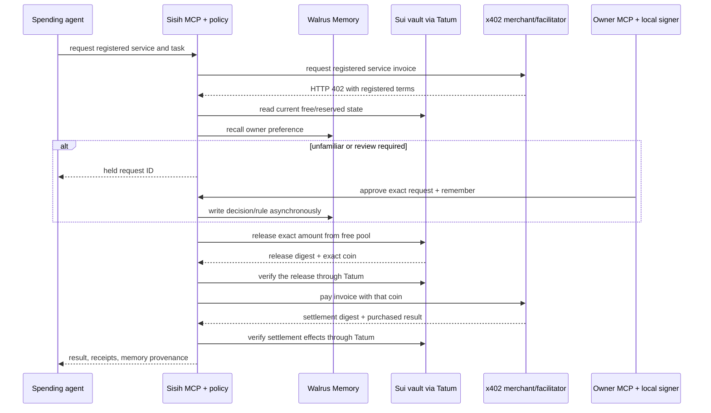

# Sisih

**An AI agent can spend only money its owner has not promised.**

A builder funds an agent's API and data purchases from the same USDC balance that must cover hosting, inference and savings. A wallet balance or static cap cannot tell which money is already committed; Sisih reserves those promises in a Sui Move vault first, releases only the live free balance, and recalls owner preferences from Walrus without letting memory override the contract.

- [Live Testnet demo](https://sisih-azure.vercel.app) — public pages are read-only without credentials.
- [Recorded Proof](https://sisih-azure.vercel.app/proof) — one real Claude Code task with Sui Testnet receipts and Walrus Memory Mainnet provenance.
- [Connect](https://sisih-azure.vercel.app/connect) — client-neutral MCP contract, separate agent/owner roles, and the local owner signer.
- [Repository](https://github.com/zkzora/sisih) — currently private; public visibility requires the owner's separate decision before submission.
- [Verified Mainnet proof](docs/evidence/mainnet-20261108/README.md) — real Codex purchases, native-USDC x402 settlement, local owner signing and Walrus recall; executed locally on 8 November. The hosted demo remains Testnet; no public Mainnet server is deployed.

Sisih is a Consumer Finance Apps entry for Tatum x Walrus “Total Recall”. No video, published blog or public repository URL is claimed here until each exists.

## Who needs it

The target user is an owner who delegates small paid API/data tasks to an external agent while keeping bills or savings in the same asset pool. If a separate prepaid agent wallet and a fixed cap already model the owner's risk, that simpler setup is preferable. Sisih helps when promises change over time and the delegated spender must see a live free balance after commitments, top-ups and other concurrent purchases.

The cost of failure is borne by the owner: an agent buys useful data but leaves insufficient funds for the next bill. Sisih prevents that delegated path onchain. It does not protect the owner from their own emergency withdrawal, prove broad market demand, or turn remembered preferences into financial authority.

## One verified example

The primary demonstrated run is Sui Mainnet, namespace `sisih-mainnet-proof-20261107`, recorded on 8 November 2026:

1. The owner deposited 3.00 native USDC: 0.80 reserved for savings and 2.20 free. Codex requested a 0.80 live ChainScope vault report through MCP.
2. Unfamiliar merchant request `req-d89525e6-87f` waited without payment. The owner approved that exact request with a local signature and remembered a seven-day preference capped at 0.80 USDC.
3. [First release](https://suiscan.xyz/mainnet/tx/6C3oTgnJYb2TH1jJiRxLR1DE87GVvY1mmfcsX2goJcms) and [x402 settlement](https://suiscan.xyz/mainnet/tx/8JyrP75EGse2BSTE4ty7afEPskptMYt6h3bv8hAjAyXB) succeeded; Codex consumed the useful live report. [Rule `rule-dfbf7042`](https://walruscan.com/mainnet/blob/dAU_UeyCw3_fRAuIEQCFQJuXKE6wnlnIJkkkkmYoJds) reached stored status on Walrus Mainnet.
4. A new application session rebuilt one rule from Walrus. In a fresh Codex conversation, `req-7dd90263-75e` settled with `allow_rule`: [release](https://suiscan.xyz/mainnet/tx/Gm1Rtgd2ty6sJ1gWxx1LSfVqNYnKnSwTkxDchfjECVE3), [settlement](https://suiscan.xyz/mainnet/tx/8ywcKQZpHDpFsZnBq4yCusuLiibDfWws6nF8FWQTBhS9).
5. Third request `req-f37bacb5-c6a` was refused: only 0.60 free remained, and the 0.80 reserve stayed protected despite the active preference. An unsigned contract simulation independently returned `EExceedsFree`; no refusal transaction was broadcast.
6. [Owner revoke](https://suiscan.xyz/mainnet/tx/3ijG4jsAk9QcV4jvffUAF3RTmwn7np39pc697PJf5LH1) left 1.40 USDC in the vault: 0.80 reserved + 0.60 free. Total merchant outflow was 1.60 USDC; net gas across eight transactions was 0.083418818 SUI.

The [Mainnet archive](docs/evidence/mainnet-20261108/README.md) contains transcripts, exact read-back of all eight receipts, a failing unrelated-digest control and four independently checked Walrus jobs/blobs. Codex was the real Mainnet model client; Claude Code hit its weekly quota before calling a tool. Read-only rule-provenance links were improved after payment and checked without another purchase. Antigravity and an owner-assistant model session remain unverified. The earlier [Claude Code Testnet archive](docs/evidence/final-run-sisih-hosted-9/README.md), with 13 stored memories, remains historical and unchanged.

## Try the proof first

No clone or credential is needed to understand the result:

1. Read [Home](https://sisih-azure.vercel.app), then [Proof](https://sisih-azure.vercel.app/proof).
2. Open the Mainnet receipts in this README or the local Proof page, then compare the recorded refusal simulation. The hosted Proof page remains the previously deployed Testnet version until a separately authorized deployment; its historical links retain `/testnet/`.
3. Compare the remembered rule provenance with the fresh-session decision and the later reserve refusal.

The hosted workspace has shared capacity: one agent run can hold its lease at a time. Private judge credentials belong in the submission form or another private channel, never in URLs, screenshots or this repository.

## Connect an external agent

One canonical endpoint, `/api/mcp`, exposes different tools based on a server-validated bearer credential. The spending agent never receives the owner credential or owner private key. The owner assistant can create exact intents; Mainnet owner transactions still require the companion CLI to inspect and sign locally.

Minimal client-neutral configuration:

```json
{
  "mcpServers": {
    "sisih": {
      "type": "http",
      "url": "https://sisih-azure.vercel.app/api/mcp",
      "headers": { "Authorization": "Bearer ${SISIH_AGENT_TOKEN}" }
    }
  }
}
```

Start with the harmless task: “Use Sisih to show my free balance, commitments, limits and available services. Do not buy anything.” The verified Testnet recipe uses Claude Code; [Connect](https://sisih-azure.vercel.app/connect) gives its constrained command and the equivalent owner connection.

For the purchase task, ask for a ChainScope vault-health report. If the result is `awaiting_owner_approval`, keep the request ID. The owner continues from a separate terminal:

```powershell
$env:SISIH_URL = 'https://sisih-azure.vercel.app'
$env:SISIH_OWNER_TOKEN = '<private owner credential>'
pnpm sisih request <request-id>
pnpm sisih approve <request-id> --remember
```

The agent then calls `get_request_status` on the same request. That read never bills again. Only an outcome of `settled` with a verified settlement receipt means payment completed; `processing`, `failed` and `unknown` must not be described as paid.

## Interfaces and authority

| Interface | Who authenticates | What it may do |
| --- | --- | --- |
| Spending-agent MCP | `SISIH_AGENT_TOKEN` | Read its budget/services, request a registered purchase, poll its own result, end its session |
| Owner-assistant MCP | distinct `SISIH_OWNER_TOKEN` | Inspect state, decide held requests, manage preferences/limits/commitments/permission, start the next session, create/read exact signing intents |
| Owner CLI | owner token plus local config; local owner key on Mainnet | Companion commands and independent local signing with `pnpm sisih sign <intent-id> --yes` |
| Public Home / Connect / Proof | no credential | Product explanation, setup contract and recorded read-only evidence |

There is no operational dashboard and no browser route that gives the spending agent owner authority. Hidden tool names, legacy owner routes and missing credentials fail closed.

The executed Mainnet proof limits owner changes to its exact purchases, session transitions and final revoke. Its spending authorization is now consumed and permission revoked. Further Mainnet configuration or spending requires a revised reviewed plan; the existing Testnet configuration workflow remains available.

## How a purchase works



Hard onchain rules: reserves are separate balances; `release_to_agent` splits only free funds; one OperatorCap; exact stored bill payees; per-request and daily caps; expiry; pause/revoke; owner-only policy and commitment changes. The selected primitive is the tested Sisih vault—see the source-linked [reuse decision](docs/mainnet/VAULT_DECISION.md). Native app-bound Allowances remain the strongest future simplification, but still need custom dynamic-reserve policy; OpenZeppelin Spend Vault budgets do not provide commitment segregation.

Soft owner rules: allow/deny a merchant up to an amount and expiry. They are written to Walrus Memory, tracked from accepted job through `stored`, and rebuilt from recall for a new session. Memory may remove a review; it cannot release reserved funds.

Tatum is the only Sui path in the application: chain identity and object/balance reads, transaction resolution/simulation/submission, and exact receipt read-back use its native gRPC gateway with throttling. x402 invoice terms are checked against the merchant registry; model-supplied price, recipient, asset or category cannot replace them. Release and settlement are separate: persistent idempotency and budget records prevent duplicate releases, and unknown outcomes stop replacement spending until reconciliation.

Relevant code: [vault.move](contracts/sisih/sources/vault.move), [policy engine](server/src/policy/engine.ts), [payment executor](server/src/services/payments.ts), [Tatum client](server/src/lib/tatum.ts), [Walrus integration](server/src/memory/memwal.ts), [role-scoped MCP](server/src/mcp/server.ts), and [local owner transaction checks](server/src/owner/tx.ts).

## Networks and status

| Environment | Vault / asset / x402 | Tatum | Walrus | Status |
| --- | --- | --- | --- | --- |
| Hosted demo | Sui Testnet package `0x37a551…886e9`, vault `0xbfb099…e962`, testnet USDC, x402 Testnet | Tatum Sui Testnet gRPC | Walrus Memory Mainnet, historical namespace `sisih-hosted-9` | Deployed; historical Claude Code run |
| Mainnet proof | Native Circle USDC; package `0xc894db…f55d`, vault `0x24649e…32fc`; two x402 settlements | All eight receipts independently read through Tatum | `sisih-mainnet-proof-20261107`, four stored memories | Executed locally with Codex; final permission revoked; primary verified run |
| Proposed public Mainnet | separate project `sisih-mainnet-proof-zkzora` | Mainnet | same proof prefix, separate state DB | Prepared target only; needs explicit deploy authorization and Postgres |

The executed authorization deposited 3.000000 USDC, reserved 0.800000, paid two 0.800000 reports and ended with 0.600000 free and revoked permission. Actual net gas was 0.083418818 SUI under the 0.205-SUI ceiling. See [authorization](docs/mainnet/EXECUTION_AUTHORIZATION.md); further spending requires a revised reviewed plan.

## Evidence, trust and limitations

- Testnet release and settlement receipts are real chain transactions; the reserve refusal is an intentional failed transaction. ChainScope returned live vault data. Other demo merchants return labeled fixed fixtures.
- The merchants and bill payees are project-operated. Payments to them are not customer revenue. Testnet “income” is simulated.
- Walrus storage is Mainnet. The new Mainnet namespace has four independently verified memories; historical `sisih-hosted-9` has 13. No artificial writes are used to reach a threshold.
- The historical Testnet owner is server-signed and explicitly labeled. The Mainnet design keeps the owner key local but holds operator, agent and facilitator keys in the deployment, so it is not fully non-custodial.
- Project contracts have Move/unit/integration evidence but no claimed third-party audit or production readiness.
- A release can succeed before merchant settlement. A timeout may leave funds at the agent or already settled. Sisih records this, refuses duplicate payment and requires read-back reconciliation.
- The learning result is narrow. In the earlier five-session run, manual reviews were **2, 1, 1, 2, 2**. Recall removed one repeated review; later reserve increases caused more holds. This proves persistence changed a decision and hard rules still won—not that memory monotonically improves review counts or beats every well-designed static policy.

## Developer setup

Prerequisites used by this repository: Node.js 24, pnpm 11.28.6, and Sui CLI for Move build/tests. The SDK is pinned in package manifests. Do not put private keys directly in shell command history.

```powershell
git clone <repository-url> Sisih
Set-Location Sisih
Copy-Item .env.example .env
# Fill the ignored .env locally; never commit it.
pnpm install --frozen-lockfile
pnpm test
pnpm typecheck
sui move test --path contracts/sisih
pnpm --filter @sisih/web build
pnpm dev
```

`--help`, preflight and default Mainnet scripts never sign or broadcast. Exact configuration, funding boundary, restart recovery and verification commands are in [RUNBOOK.md](docs/mainnet/RUNBOOK.md). The reviewed specification is [MANIFEST.json](docs/mainnet/MANIFEST.json); [funded preflight](docs/mainnet/preflight-funded.json) and [final evidence](docs/evidence/mainnet-20261108/README.md) establish actual execution. The completed allocation must not be replayed.

Repository map:

- `contracts/sisih` — Move vault and tests.
- `server/src` — policy, role-scoped MCP, Tatum, Walrus, owner intents/CLI and x402.
- `web/src/app` — public Home, Connect and Proof plus server routes.
- `docs/evidence` — recorded Mainnet proof and unchanged historical Testnet evidence.
- `docs/mainnet` — primitive decision, exact manifest and executable runbook.

## Submission context

Track: Consumer Finance Apps. Meaningful integrations are Tatum for every consequential Sui path and Walrus Memory for owner decisions that visibly change a later session. x402-on-Sui and deep-memory-loop bonuses are judging criteria, not guaranteed awards. Mainnet Sui execution is a project goal, not stated as a mandatory hackathon requirement. Draft blog, recording and social copy remain unpublished artifacts under `docs/`.

## License

MIT — see [LICENSE](LICENSE).
