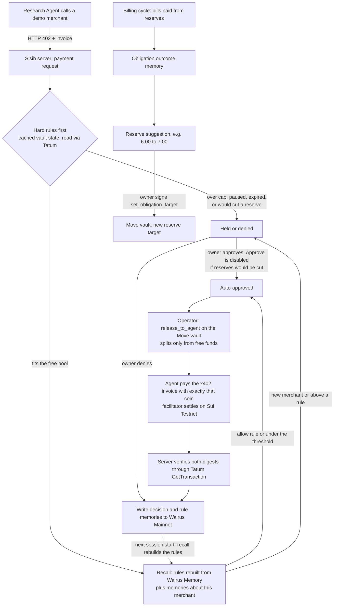

# Sisih

**Your AI agent can only spend money you haven't promised.**

**Live demo:** https://sisih-azure.vercel.app (no setup; read-only for visitors, judges get a demo
token through the submission form)

Sisih is a USDC vault for people who give an AI agent a budget. Committed money (hosting, inference
bills, savings, renewals) is reserved in a Move contract on Sui first; the agent can only be paid from
what is left. What the owner decides about the agent's purchases is remembered in Walrus Memory, so
the next session needs fewer manual reviews, but no memory can ever unlock reserved funds.

Hackathon entry for Tatum x Walrus "Total Recall", Consumer Finance Apps track.

## Who it is for, and the problem

The target user is a builder or power user who lets an AI research agent pay for APIs and data
(x402 micropayments) out of the same USDC they use for recurring commitments.

- A wallet balance looks spendable, but most of it is already promised to next week's bills. An
  agent with a simple spending limit can still spend the hosting money.
- Approving every small purchase by hand defeats the point of an agent; approving nothing by hand is
  risky.
- The agent and its tools forget the owner's past decisions between sessions.

Sisih separates the two kinds of rules. **Hard rules** live on chain and cannot be talked around:
reserves for each commitment, a per-request cap, a daily cap and a permission expiry. **Soft rules**
are learned from the owner: trusted merchants, automatic categories, per-merchant limits. They are
stored in Walrus Memory and rebuilt every session, and they only ever decide among payments the vault
would already allow.

## Networks

| Part | Network | How |
| --- | --- | --- |
| Move vault (reserves, caps, permission), agent releases, bill payments | **Sui Testnet** | package `0x37a5513a911110d00b9c795390d1af5b04a3873e6df4856b54ede7e74ba886e9`, vault [`0xbfb0…e962`](https://suiscan.xyz/testnet/object/0xbfb09999511c994267cc79aa4d28de859004a0ff3b91de30155c8ee205fae962) |
| x402 settlement with the demo merchants | **Sui Testnet** | network id `sui:testnet`, testnet USDC |
| Every Sui read and write | **Tatum Sui Testnet gRPC gateway** | `sui-testnet-grpc.gateway.tatum.io:443`, server side only |
| Walrus Memory | **Walrus Mainnet** | relayer `https://relayer.memory.walrus.xyz`, server-side delegate key |

The dashboard says this in every screen's banner: "Sui Testnet · Walrus Memory Mainnet". Testnet
USDC has no monetary value; every amount below is testnet USDC.

## How a payment flows



## Hard rules (Move) and soft preferences (Walrus)

| Hard rules, enforced by `contracts/sisih/sources/vault.move` | Soft preferences, kept in Walrus Memory |
| --- | --- |
| Each commitment has a reserve; `release_to_agent` splits only from the free pool (`EExceedsFree`) | Merchants the owner trusts, with a per-merchant limit and an expiry ("Always allow search from SearchBox up to 1.50 USDC") |
| Per-request cap (`EOverPerRequest`) and 24 h window (`EOverDaily`) | Merchants the owner refused ("Always deny research from ReportLab up to 3.00 USDC") |
| Permission expiry, pause, revoke (`EAgentExpired`, `EAgentPaused`, `ENoAgentPolicy`) | Default automatic threshold (0.50 USDC) |
| Only the operator cap can release to the agent; only the owner can withdraw: `withdraw_free` takes free funds only, and `emergency_withdraw_all` empties the vault and removes every commitment as one explicit owner action | Decisions, bill outcomes, reserve changes and session summaries as context for recall |

The policy engine (`server/src/policy/engine.ts`) checks the hard rules before it looks at any
memory, and the contract checks them again on chain. Tests: `server/src/policy/engine.test.ts`
("hard rules come before memory") and 46 Move tests in `contracts/sisih/tests/vault_tests.move`.

## Tatum

All Sui access goes through one module, `server/src/lib/tatum.ts`: `SuiGrpcClient` from
`@mysten/sui` over native gRPC (`@protobuf-ts/grpc-transport` + `@grpc/grpc-js`) to Tatum's Sui
gateway, API key in the `x-api-key` header. Tatum's JSON-RPC route returns 404 since Sui deprecated
JSON-RPC, and the gRPC-web transport does not work against it, so the browser never talks to Sui: it
calls `/api/sui-rpc` (`web/src/app/api/sui-rpc/route.ts`), which uses the same client server side.

- Reads: vault object (`GetObject` in `server/src/chain/vault.ts`), balances (`GetBalance`), reference
  gas price.
- Proof: every transaction we know about is read back with `GetTransaction` (effects and events) in
  `verifyTransaction` / `recordTx`; the activity feed shows "verified via Tatum" only after that.
- Writes: `ExecuteTransaction` for operator releases, bill payments, reserve funding, the owner's
  wallet-signed transactions and x402 settlement (the x402 library gets our Tatum client through its
  `clientRegistry`, `server/src/x402/facilitator.ts`).
- The free plan allows 3 requests per second, so `tatum.ts` keeps one call in flight at least 400 ms
  apart and retries 429 / UNAVAILABLE. The dashboard never polls Tatum; it reads the server's cached
  vault state.

## Walrus Memory

`server/src/memory/memwal.ts`, SDK `@mysten-incubation/memwal`, relayer on Walrus Mainnet.

- Memory types, tagged `[sisih:v1:<type>]` (`server/src/memory/format.ts`): `decision`, `rule`,
  `rule_disabled`, `obligation_outcome`, `reserve_change`, `session_summary`, `merchant_note`.
- `remember()` is an async job: the row is "writing" until the relayer finishes; the job id is saved
  as soon as the relayer accepts it, and a poll finishes any write whose server function died.
- Every session start rebuilds the rules from Walrus recall (`loadRules`: tag queries for rule and
  rule_disabled plus a broad recall, merged by rule id); Postgres only caches them.
- Every payment request also recalls memories about that merchant and shows them, with distances,
  in the request drawer.

How memory changes a decision, from the documented run: in session 1 SearchBox (1.20) was held as a
new merchant and the owner chose "Approve & remember", which wrote a rule memory. Session 2 rebuilt 2
rules from Walrus, and the same SearchBox request was approved automatically with basis `allow_rule`.

## x402 on Sui

`@tentaclepay/sui-x402` + `@x402/core` (x402 V2). Demo merchants (`server/src/x402/merchants.ts`,
labeled demo) answer `402 Payment Required`; the agent (`server/src/x402/agentPay.ts`) asks Sisih for
the payment, the operator releases exactly that amount from the vault's free pool, and the agent pays
with exactly that coin (`assertPaysFromCoin` refuses anything else). The facilitator verifies,
co-signs as gas owner and settles; the server then verifies the settlement digest through Tatum.

## Evidence (documented run, 2026-11-06, Sui Testnet + Walrus Mainnet)

Recorded in [docs/PROGRESS.md](docs/PROGRESS.md) (Phase 5), with a snapshot of the public API at
the end of the run in [docs/evidence/sisih-hosted-6](docs/evidence/sisih-hosted-6). Walrus Memory
namespace `sisih-hosted-6`: 35 memories stored, also listed by the Walrus Memory SDK from the mainnet
relayer.

| What | Evidence |
| --- | --- |
| Seed: 20.00 deposited, 16.50 reserved | [8dQKZDKA…L1sZ](https://suiscan.xyz/testnet/tx/8dQKZDKAAbQ5Lx5d3eU7WQFpmX4mDip3KubfmzoHL1sZ) |
| DataMart 0.50 auto: release / x402 settle | [2Ju96fSr…Sy3A](https://suiscan.xyz/testnet/tx/2Ju96fSrg2qk1iJcy41x4LsYTd6cSeSo59Lcu2zVSy3A) / [EC38SWXo…MjvC](https://suiscan.xyz/testnet/tx/EC38SWXoisFLojvYwkuD4xckwHkVTnvG8m2JwkNJvjMC) |
| SearchBox 1.20 approved by the owner: release / settle | [BPQsJKfz…578f](https://suiscan.xyz/testnet/tx/BPQsJKfz6YTwU7kuq1gYi7FfoKiPYLas8jzZ4jh4578f) / [5SwM31dV…VvNz](https://suiscan.xyz/testnet/tx/5SwM31dV71TcmdA9kT1MJfqKD3nveSKo9sAuTecoVvNz) |
| SearchBox rule memory | [pzgbmXXn…GneA](https://walruscan.com/mainnet/blob/pzgbmXXnEEVdL1ApgYfg0zdvc-SOZUWKzLMvzyBGneA) |
| Session 2: SearchBox auto by the rule: release / settle | [nYxWRpJk…o436](https://suiscan.xyz/testnet/tx/nYxWRpJk31MyFQYAiQD6ffRiou7c1UrDZgJBKm5o436) / [5jqPJmRq…mK](https://suiscan.xyz/testnet/tx/5jqPJmRqi4QjayKn1RfhCdoJDeLBv8UuG95pGVAY1UmK) |
| Inference API bill 6.80 vs 6.00 reserve | outcome memory [UMqAuiVX…Ds8](https://walruscan.com/mainnet/blob/UMqAuiVX1Yoxcqc2ebS2PJp8NpObkOEADrw75nV7Ds8) |
| Owner accepts the 7.00 reserve | [6DaXxdwo…7veL](https://suiscan.xyz/testnet/tx/6DaXxdwoEotRTRzT3Mqio9sMDKL7NCwimDpDQxPa7veL) |
| Contract refuses a 1.20 release with 0.70 free (memory allowed up to 1.50) | [3QcakorF…GeM](https://suiscan.xyz/testnet/tx/3QcakorFNa8YhAaXHdv8wHU39kYXnis4EdJA6mLhRGeM), `EExceedsFree` |

Manual reviews per session in that run: 2, 1, 1, 2, 2. Sessions 1 and 2 ran through the UI; sessions
3 to 5 were scripted (`pnpm demo:continue`) with one fixed owner decision rule. Reviews rose again in
sessions 4 and 5 because a higher Inference reserve left little free money, so SearchBox was held by
the reserve check even though its rule was still active. These are five demo sessions in one
workspace, not users or a measure of production effectiveness.

## Demo boundaries

- DataMart, SearchBox and ReportLab are demo merchants run by us; the bill payees are our own demo
  addresses, and demo funds are swept back (`server/src/demo/recycle.ts`).
- Testnet USDC only. Billing income is simulated (17.00 per cycle) and a demo cycle is 2 minutes.
- On testnet, with the demo token and no wallet connected, deposits, reserve suggestions, pause and
  resume are signed on the server and labeled "Demo owner (server-signed, testnet)" in the UI and in
  the activity feed. This is refused on mainnet. A connected owner wallet signs everything itself.
- One visitor runs the demo at a time; everyone else sees it read-only.
- Sisih is a hackathon build, not audited and not production-ready. It has not been validated with
  customers.

## Run it from a fresh clone

Requirements: Node 24, pnpm 11 (`corepack enable`), the Sui CLI for contract work, a Tatum API key
(testnet), a Walrus Memory account with a delegate key (memory.walrus.xyz), testnet SUI and testnet
USDC.

```sh
git clone <this repo> && cd Sisih
pnpm install
cp .env.example .env            # fill in keys; wallets: sui keytool generate ed25519
pnpm test && pnpm typecheck     # web + server suites
cd contracts/sisih && sui move test && cd ../..
```

Deploy your own vault on testnet (writes the IDs into `.env`), seed the SPEC starting state, then run
the app:

```sh
pnpm --filter @sisih/server exec tsx scripts/publish.ts
pnpm --filter @sisih/server exec tsx scripts/seed-vault.ts
pnpm --filter @sisih/web build && cd web && npx next start --port 3000
```

Open http://127.0.0.1:3000. Locally the server keeps app state in embedded PGlite
(`DATABASE_URL=pglite:./server/data/pglite`); the hosted app uses Supabase Postgres. Headless runs:
`pnpm demo:run` (reset, sessions 1 and 2, asserts the SPEC tables) and `pnpm demo:continue`
(sessions 3 to 5).

## Repo layout

| Path | What |
| --- | --- |
| `contracts/sisih` | Move package `sisih::vault` and its tests |
| `server/src` | Hono app: policy engine, Tatum client, Walrus Memory client, agent runner, x402 merchants and facilitator, demo controls, event feed |
| `web` | Next.js dashboard; also hosts the server through route handlers (one Vercel project) |
| `docs` | [SPEC](docs/SPEC.md), [build plan](docs/BUILD_PLAN.md), [progress and evidence](docs/PROGRESS.md), [blog draft](docs/BLOG.md), [recording guide](docs/RECORDING.md) |

## License

MIT, see [LICENSE](LICENSE).
