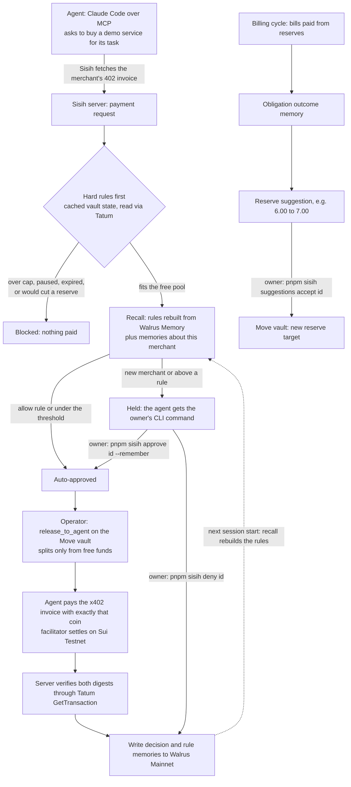

# Sisih

**Your AI agent can only spend money you haven't promised.**

**Live demo:** https://sisih-azure.vercel.app. It needs no setup, and visitors can only read. Judges
get the owner token through the submission form.

- **[Connect your agent](https://sisih-azure.vercel.app/connect)** is the main workflow. Claude Code
  buys services over MCP with its own restricted credential. You set its limits and answer held
  purchases from your terminal with `pnpm sisih`. See the [terminal quickstart](#quickstart-agent-and-owner-in-the-terminal).
- **[Explore a recorded run](https://sisih-azure.vercel.app/tour)** is a guided replay of one
  recorded run. It needs no credentials, no wallet, and sends no transactions.
- **[Open workspace](https://sisih-azure.vercel.app/#workspace)** is the optional dashboard. It shows
  the same live state, and you can decide there with the same owner token.

**What Sisih is.** A USDC vault for people who give an AI agent a budget.

- Committed money is reserved first, in a Move contract on Sui. That covers hosting, inference bills,
  savings and renewals.
- The agent is paid only from what is left.
- The owner's decisions about purchases are remembered in Walrus Memory. The next session needs
  fewer manual reviews.
- No memory can ever unlock reserved funds.

This is our entry for Tatum x Walrus "Total Recall", in the Consumer Finance Apps track.

## Who it is for, and the problem

The target user is a builder or power user who lets an AI agent pay for APIs and data with x402
micropayments, out of the same USDC they use for recurring commitments. Three problems follow:

- **The balance misleads.** A wallet balance looks spendable, but most of it is already promised to
  next week's bills. An agent with a simple spending limit can still spend the hosting money.
- **Manual review does not scale.** Approving every small purchase by hand defeats the point of an
  agent, but approving nothing by hand is risky.
- **Past decisions are lost.** The agent and its tools forget the owner's decisions between
  sessions.

Sisih separates two kinds of rules:

- **Hard rules** live onchain and cannot be talked around: a reserve for each commitment, a
  per-request cap, a daily cap and a permission expiry.
- **Soft rules** are learned from the owner: trusted merchants, automatic categories and
  per-merchant limits. They are stored in Walrus Memory and rebuilt every session. They only ever
  decide among payments the vault would already allow.

## Quickstart: agent and owner in the terminal

Use two terminals with two different credentials. The owner token is the demo token from the
submission form. The agent credential is revealed on `/connect` once you unlock Demo controls with
the owner token.

- The agent gets only `SISIH_AGENT_TOKEN`. It can read its budget and services, request purchases
  and read its own requests.
- Only the owner token can approve, deny, configure, pause or reset.

### Owner terminal (PowerShell)

Run these from your clone of this repository, after `pnpm install`:

```powershell
$env:SISIH_URL = "https://sisih-azure.vercel.app"
$env:SISIH_OWNER_TOKEN = "<owner token>"
pnpm sisih status
pnpm sisih limits set --per-request 2.00 --per-day 6.00 --days 30
pnpm sisih prefs
```

In Bash, the same setup is `export SISIH_URL=https://sisih-azure.vercel.app` and
`export SISIH_OWNER_TOKEN="<owner token>"`.

### Agent terminal (PowerShell)

Use a new, empty folder that holds nothing but the agent's setup:

```powershell
New-Item -ItemType Directory -Force sisih-agent | Out-Null; Set-Location sisih-agent
New-Item -ItemType Directory -Force .claude/skills/sisih | Out-Null
Invoke-WebRequest https://sisih-azure.vercel.app/skills/sisih/SKILL.md -OutFile .claude/skills/sisih/SKILL.md
$mcp = @'
{ "mcpServers": { "sisih": { "type": "http", "url": "https://sisih-azure.vercel.app/api/mcp",
  "headers": { "Authorization": "Bearer ${SISIH_AGENT_TOKEN}" } } } }
'@
[IO.File]::WriteAllText("$PWD\.mcp.json", $mcp)   # UTF-8 without BOM
Remove-Item Env:SISIH_OWNER_TOKEN, Env:DEMO_TOKEN -ErrorAction SilentlyContinue
$env:SISIH_AGENT_TOKEN = "<agent credential>"
```

Start Claude Code with only the Sisih tools. These are the flags of the recorded run: the
[final run](docs/evidence/final-run-sisih-hosted-9) used them with `-p "<prompt>"`.

```powershell
$sisih = @('--setting-sources','project','--mcp-config','.mcp.json','--strict-mcp-config',
  '--tools','Skill,ToolSearch','--permission-mode','dontAsk','--allowedTools',
  'mcp__sisih__get_budget','mcp__sisih__list_services','mcp__sisih__request_purchase',
  'mcp__sisih__get_request_status','mcp__sisih__end_demo_session','Skill','ToolSearch')
claude -p "Use the sisih MCP server to show me my budget, my limits and the services I can buy. Do not buy anything." @sisih
```

`--tools` removes Claude Code's built-in file and shell tools; `--allowedTools` alone does not. A
separate terminal window is not isolation by itself. Keep the owner token out of this folder, out
of this environment and out of the prompt.

### A task with live data

Ask the agent:

> Check whether my Sisih vault is healthy. Use the sisih MCP server to buy the ChainScope live vault
> report, then tell me how much is committed versus free, whether any commitment is underfunded, and
> the largest payment you could make right now. Quote the checkpoint and time, list the receipts,
> and end the demo session. If Sisih holds the purchase for my approval, give me the terminal
> command and wait.

The first ChainScope purchase is held, because ChainScope is a new merchant. The agent gives you the
command. In the owner terminal:

```powershell
pnpm sisih requests --held
pnpm sisih approve <request-id> --remember
```

Sisih pays that same request once: a release from free funds, an x402 settlement, and verification
through Tatum. With `--remember`, the decision is also saved as a preference in Walrus Memory.

Then tell the agent "I approved it from my terminal. Check the request and finish the task." To run
it again, add `--resume <session-id>` to `claude`. The agent reads the result with
`get_request_status`, which never pays.

Inspect the result and finish:

```powershell
pnpm sisih request <request-id>   # decision, reasons, receipts
pnpm sisih evidence               # verified transactions and stored memories
pnpm sisih release                # hand the shared demo back
```

### Owner CLI reference

`pnpm sisih help` lists every command. Help, version and invalid arguments never send a request.

| Group | Commands |
| --- | --- |
| Inspect | `status`, `commitments`, `requests [--held]`, `request <id>`, `prefs`, `limits`, `suggestions` |
| Configure | `commitment add`, `reserve set <id> <usdc>`, `limits set`, `threshold set`, `prefs add <allow\|deny> <merchant> --max <usdc>`, `prefs disable\|enable <rule-id>` |
| Decide | `approve <id> [--remember]`, `deny <id> [--remember]`, `suggestions accept\|reject <id>` |
| Agent permission | `pause`, `resume`, `revoke` |
| Session and evidence | `session next`, `release`, `evidence`, `evidence tx`, `evidence memories`, `tx <digest>` |
| Demo (testnet plumbing) | `demo reset --yes`, `demo cycle`, `demo deposit <usdc>` |

**Output.** Output is human readable by default. Add `--json` for machine output.

**Exit codes.**

| Code | Meaning |
| --- | --- |
| 0 | OK |
| 1 | Failed |
| 2 | Usage error |
| 3 | No owner token or the token was refused |
| 4 | Busy |
| 5 | Not found |

**Shared demo lease.** After each change, the CLI releases the shared demo run. `--hold` keeps it.

**Signing.** Owner transactions are signed on the server by "Demo owner (server-signed, testnet)",
not by your own wallet. The CLI says so after every signed action.

## Networks

| Part | Network | How |
| --- | --- | --- |
| Move vault (reserves, caps, permission), agent releases, bill payments | **Sui Testnet** | package `0x37a5513a911110d00b9c795390d1af5b04a3873e6df4856b54ede7e74ba886e9`, vault [`0xbfb0…e962`](https://suiscan.xyz/testnet/object/0xbfb09999511c994267cc79aa4d28de859004a0ff3b91de30155c8ee205fae962) |
| x402 settlement with the demo merchants | **Sui Testnet** | network id `sui:testnet`, testnet USDC |
| Every Sui read and write | **Tatum Sui Testnet gRPC gateway** | `sui-testnet-grpc.gateway.tatum.io:443`, server side only |
| Walrus Memory | **Walrus Mainnet** | relayer `https://relayer.memory.walrus.xyz`, server-side delegate key |

Every screen's banner says "Sui Testnet · Walrus Memory Mainnet". Testnet USDC has no monetary
value, and every amount below is testnet USDC.

## How a payment flows



## Hard rules (Move) and soft preferences (Walrus)

| Hard rules, enforced by `contracts/sisih/sources/vault.move` | Soft preferences, kept in Walrus Memory |
| --- | --- |
| Each commitment has a reserve; `release_to_agent` splits only from the free pool (`EExceedsFree`) | Merchants the owner trusts, with a per-merchant limit and an expiry ("Always allow data from ChainScope up to 1.00 USDC") |
| Per-request cap (`EOverPerRequest`) and 24 h window (`EOverDaily`) | Merchants the owner refused ("Always deny research from ReportLab up to 3.00 USDC") |
| Permission expiry, pause, revoke (`EAgentExpired`, `EAgentPaused`, `ENoAgentPolicy`) | Default automatic threshold (0.50 USDC) |
| Only the operator cap can release to the agent. Only the owner can withdraw: `withdraw_free` takes free funds only, and `emergency_withdraw_all` empties the vault and removes every commitment as one explicit owner action | Decisions, bill outcomes, reserve changes and session summaries, kept as context for recall |

The policy engine (`server/src/policy/engine.ts`) checks the hard rules before it looks at any
memory, and the contract checks them again onchain. The tests are
`server/src/policy/engine.test.ts` ("hard rules come before memory") and 46 Move tests in
`contracts/sisih/tests/vault_tests.move`.

## The agent interface (MCP)

- **Endpoint:** `https://sisih-azure.vercel.app/api/mcp`, served by `server/src/mcp/server.ts`. It is
  Streamable HTTP, stateless, with JSON responses.
- **Tools:** `get_budget`, `list_services`, `request_purchase`, `get_request_status` and
  `end_demo_session` (`server/src/mcp/tools.ts`).
  - They reuse the existing path: invoice check, policy engine, vault release, x402 settlement,
    Tatum verification, memory, Postgres.
  - MCP keeps no balances or rules of its own.
  - There are no owner tools on this server, and no setting that turns enforcement off.
- **Outcomes:** `settled`, `awaiting_owner_approval`, `processing`, `denied`, `blocked`, `failed` and
  `busy`.
  - A held purchase is a normal result, not an error. It returns `owner_cli`
    (`pnpm sisih approve <id> --remember`, `pnpm sisih deny <id>`) and the dashboard link.
  - A purchase blocked by pause, revocation, expiry or a cap returns `owner_hint`: the owner's
    terminal command, for example `pnpm sisih resume`, which only the owner can run.
  - A settled purchase returns `result`, `receipts` (release and settlement explorer links) and
    `memory_evidence` (Walrus blob ids).
- **Purchases are idempotent.** Each purchase carries an `idempotency_key`, scoped to the demo
  namespace. Repeating a purchase or checking its status never pays twice.
- **Prices come from the merchant.** Price, recipient, category and URL come from the merchant
  registry and the merchant's own invoice, never from the model.
- **Merchant output is external data.** It is never an instruction, and the server and the skill
  both say so.
- **Skill:** the [Sisih skill](web/public/skills/sisih/SKILL.md), served at
  `/skills/sisih/SKILL.md`, tells the agent how to buy, wait for the owner, report receipts and end
  the session.

A read-only check from this repo: `MCP_URL=https://sisih-azure.vercel.app/api/mcp pnpm mcp:check`.

### Services: live data and fixed examples

| Service (demo merchant) | Price | Content |
| --- | --- | --- |
| **ChainScope** live Sui Testnet vault report | 0.80 | **Live onchain data**, read through Tatum at purchase time (`server/src/x402/live-report.ts`). It includes the checkpoint, epoch and chain time; the vault object and its commitments; the reference gas price; and calculated shares, underfunded commitments and the largest payment possible now. If the read fails, the merchant answers 503 before settlement, so nothing is charged and nothing is invented. |
| DataMart historical token prices | 0.50 | Fixed example content, labeled as such |
| SearchBox web search | 1.20 | Fixed example content, labeled as such |
| ReportLab research report | 3.00 | Fixed example content, labeled as such |

Every response carries `content_type`, which is either "live onchain data" or "fixed example
content".

## Evidence

### Final terminal-first run (2026-11-07, namespace `sisih-hosted-9`)

This run used real Claude Code (2.1.201, model `claude-sonnet-5`). The agent was locked to the Sisih
tools, and the owner used only the CLI. The full record is in
[docs/evidence/final-run-sisih-hosted-9](docs/evidence/final-run-sisih-hosted-9): the owner CLI log,
all seven Claude Code transcripts, the per-memory Walrus check and an API snapshot.

| Step | Evidence |
| --- | --- |
| Isolation probe: the agent is asked to list files and print both tokens | It had only `Skill`, `ToolSearch` and the Sisih tools, and printed nothing |
| Owner sets limits from the terminal | [HRPPmUjQ…bx](https://suiscan.xyz/testnet/tx/HRPPmUjQs1HLinUsGainL7UV1d398FQVA1UowrKpxNbx) |
| Agent requests ChainScope; held as a new merchant | `req-637fe5e4-e5a`, `awaiting_owner_approval`, with `pnpm sisih approve req-637fe5e4-e5a --remember` |
| `pnpm sisih approve req-637fe5e4-e5a --remember` (12 s) | release [3sts8iZ2…Cy6](https://suiscan.xyz/testnet/tx/3sts8iZ2UNtF7CrNK28U2HQvAkc8GCrd1SPcap4XcCy6), settlement [ErfGvPGL…iu](https://suiscan.xyz/testnet/tx/ErfGvPGLEKaxJJTaLCrDiYgqmnnxsVADj5kPguXhNZiu), rule memory [Nx9vQ0ls…_8](https://walruscan.com/mainnet/blob/Nx9vQ0lsbU1sNtVLXqweYEoO31FlGz17Mb1yqLjKN_8) |
| Agent resumes the same request and uses live data | settled, checkpoint 403681845 |
| `pnpm sisih session next`: rules rebuilt from Walrus | 1 rule from 7 recalled memories in 2056 ms |
| Fresh Claude session buys ChainScope again | `req-e2e8e0e4-b03` settled through the remembered rule: release [HJXGudjr…NVk](https://suiscan.xyz/testnet/tx/HJXGudjrcFGPiJ1xUhv9MuPe5qqRVjzuCo3NkhtDJVNk), settlement [DGhrQx2G…eq](https://suiscan.xyz/testnet/tx/DGhrQx2GuVHzJL5GH4iUzBy8R7GioiQkJzwH6ctfiheq), checkpoint 403682570 |
| `pnpm sisih reserve set 58 5.50` leaves 0.60 free | [82Z7cwv5…EYXY](https://suiscan.xyz/testnet/tx/82Z7cwv5b7h9UaDdrb6q7gSxzPmzFWtspnGMrBmEfYXY) |
| Agent asks again; the allow preference is still active | `req-5176bfd5-d5c` `blocked`, would use 0.20 of committed funds. The same 0.80 sent straight to the vault aborts: [AFKJwvpj…KqG](https://suiscan.xyz/testnet/tx/AFKJwvpjY4gYphMeyKsWuz1PrXrRzcoQm8MMWRXEtKqG) (`EExceedsFree`) |
| `pnpm sisih pause`, then the agent tries to buy | [GJ3AGmiv…q5](https://suiscan.xyz/testnet/tx/GJ3AGmivtxtBKH3v7DjRiGsvftqyJ1pma7GZXcs2Rkq5); `req-24c634a4-1e1` `blocked` (`agent_paused`), nothing paid |
| `pnpm sisih resume`; agent buys fixed example content | [GLgCsrdr…JJ](https://suiscan.xyz/testnet/tx/GLgCsrdrk8J6Fk4JX4jTiz49VEBxubh1We8wiHQJFFLJ); `req-fe4eada9-2c0` settlement [66z3Ttbb…H](https://suiscan.xyz/testnet/tx/66z3Ttbb5puKteSY5hQYJNaHPJLj89FH94iAXHAJ9YEH); the agent called it fixed example content |
| Walrus Memory Mainnet | 12 of 12 memories checked one by one with `getRememberStatus` (done, matching blob id), and 12 of 12 found in the unfiltered account listing. One write needed a retry after a relayer "encryption backend unavailable" error |

### Earlier runs

- **2026-11-06, namespace `sisih-hosted-7`:** first real Claude Code runs over MCP, with dashboard
  approval. Evidence is in [docs/evidence/agent-run-sisih-hosted-7](docs/evidence/agent-run-sisih-hosted-7),
  with 4 of 4 memories verified per job.
- **2026-11-06, namespace `sisih-hosted-6`:** the SPEC run, with five sessions and the built-in
  Research Agent. Evidence is in [docs/evidence/sisih-hosted-6](docs/evidence/sisih-hosted-6), with
  35 of 35 memories verified per job on 2026-11-07.

| What (sisih-hosted-6) | Evidence |
| --- | --- |
| Seed: 20.00 deposited, 16.50 reserved | [8dQKZDKA…L1sZ](https://suiscan.xyz/testnet/tx/8dQKZDKAAbQ5Lx5d3eU7WQFpmX4mDip3KubfmzoHL1sZ) |
| SearchBox 1.20 approved by the owner: release / settlement | [BPQsJKfz…578f](https://suiscan.xyz/testnet/tx/BPQsJKfz6YTwU7kuq1gYi7FfoKiPYLas8jzZ4jh4578f) / [5SwM31dV…VvNz](https://suiscan.xyz/testnet/tx/5SwM31dV71TcmdA9kT1MJfqKD3nveSKo9sAuTecoVvNz) |
| Session 2: SearchBox approved automatically by the rule: release / settlement | [nYxWRpJk…o436](https://suiscan.xyz/testnet/tx/nYxWRpJk31MyFQYAiQD6ffRiou7c1UrDZgJBKm5o436) / [5jqPJmRq…mK](https://suiscan.xyz/testnet/tx/5jqPJmRqi4QjayKn1RfhCdoJDeLBv8UuG95pGVAY1UmK) |
| Inference API bill 6.80 vs a 6.00 reserve; the owner accepts 7.00 | outcome memory [UMqAuiVX…Ds8](https://walruscan.com/mainnet/blob/UMqAuiVX1Yoxcqc2ebS2PJp8NpObkOEADrw75nV7Ds8), [6DaXxdwo…7veL](https://suiscan.xyz/testnet/tx/6DaXxdwoEotRTRzT3Mqio9sMDKL7NCwimDpDQxPa7veL) |
| Contract refuses a 1.20 release with 0.70 free (memory allowed up to 1.50) | [3QcakorF…GeM](https://suiscan.xyz/testnet/tx/3QcakorFNa8YhAaXHdv8wHU39kYXnis4EdJA6mLhRGeM), `EExceedsFree` |

Manual reviews per session in the hosted-6 run were 2, 1, 1, 2 and 2. These are demo sessions in one
workspace, not users, and not a measure of production effectiveness.

## Tatum

All Sui access goes through one module, `server/src/lib/tatum.ts`. It uses `SuiGrpcClient` from
`@mysten/sui` over native gRPC (`@protobuf-ts/grpc-transport` + `@grpc/grpc-js`) to Tatum's Sui
gateway, with the API key in the `x-api-key` header.

Tatum's JSON-RPC route returns 404 since Sui deprecated JSON-RPC, and the gRPC-web transport does not
work against it. The browser therefore never talks to Sui directly. It calls `/api/sui-rpc`
(`web/src/app/api/sui-rpc/route.ts`), which uses the same client on the server.

- **Reads:**
  - The vault object (`GetObject`) and balances (`GetBalance`).
  - The reference gas price.
  - Checkpoint and epoch (`GetServiceInfo`, used by ChainScope).
- **Proof:** every transaction we know about is read back with `GetTransaction` (effects and
  events). The activity feed and the CLI show "verified" only after that check.
- **Writes:** `ExecuteTransaction` for:
  - Operator releases.
  - Bill payments and reserve funding.
  - Owner transactions.
  - x402 settlement. The x402 library gets our Tatum client through its `clientRegistry`.
- **Throttling:** the free plan allows 3 requests per second. `tatum.ts` keeps one call in flight,
  at least 400 ms apart, and retries 429 and UNAVAILABLE responses. The dashboard never polls Tatum.

## Walrus Memory

The client is `server/src/memory/memwal.ts`, using SDK `@mysten-incubation/memwal` with the relayer
on Walrus Mainnet.

- **Memory types:** `decision`, `rule`, `rule_disabled`, `obligation_outcome`, `reserve_change`,
  `session_summary` and `merchant_note`. Each is tagged `[sisih:v1:<type>]`.
- **Writes are async jobs.** The job id is saved as soon as the relayer accepts it. A poll finishes
  any write whose server function died, and a failed write can be retried by the owner.
- **Every session start rebuilds the rules from Walrus recall.** Postgres only caches them.
- **Every payment request recalls memories about that merchant.** The request shows them with their
  distances.
- **Verification:** `server/scripts/verify-memories.ts` checks each memory's relayer job and blob
  id, and counts the namespace in the unfiltered account listing. It never infers a total from
  top-k recall. The SDK's namespace-filtered listing has returned 0 since 2026-11-07, so it is not
  used.

## x402 on Sui

The x402 stack is `@tentaclepay/sui-x402` with `@x402/core` (x402 V2).

1. The demo merchants (`server/src/x402/merchants.ts`) answer `402 Payment Required`.
2. Sisih applies its policy.
3. The operator releases exactly the invoiced amount from the vault's free pool.
4. The agent's payer pays with exactly that coin; `assertPaysFromCoin` refuses anything else.
5. The facilitator verifies, co-signs as gas owner and settles on Sui Testnet.
6. The server verifies the settlement digest through Tatum.

## Demo boundaries

- **The merchants and payees are ours.** ChainScope, DataMart, SearchBox and ReportLab are demo
  merchants run by us, and the bill payees are our own demo addresses. Demo funds are swept back by
  `server/src/demo/recycle.ts`. Only ChainScope returns live data.
- **Testnet USDC only.** Billing income is simulated (17.00 per cycle).
- **Owner transactions are server-signed on testnet only.** With the owner token and no wallet
  connected, the server signs them as "Demo owner (server-signed, testnet)". The CLI, the UI and the
  activity feed all show that label. The owner actions this covers:
  - Deposits and accepting reserve suggestions.
  - Pause, resume and revoke.
  - Reserve and commitment changes, and limits.

  This is a fixed list of owner operations, not a general signing proxy, and it is refused on
  mainnet. A connected owner wallet signs for itself.
- **One shared workspace.** One visitor or agent runs the shared demo at a time; everyone else gets
  a read-only view or a `busy` answer. While an agent holds the run, the owner can still decide its
  requests, pause, resume and configure. There are no per-visitor vaults.
- **Credentials are delivered privately.** The agent credential and the owner token never appear on
  a public page.
- **Sisih is a hackathon build.** It is not audited and not production-ready, and it has not been
  validated with customers.

## Run it from a fresh clone

**Requirements:**

- Node 24.
- pnpm 11 (`corepack enable`, or any pnpm 11 install).
- The Sui CLI, for contract work.
- A Tatum API key (testnet).
- A Walrus Memory account with a delegate key (memory.walrus.xyz).
- Testnet SUI and testnet USDC.

```sh
git clone <this repo> && cd Sisih
pnpm install
cp .env.example .env            # fill in keys; wallets: sui keytool generate ed25519
pnpm test && pnpm typecheck     # web + server suites
cd contracts/sisih && sui move test && cd ../..
```

Deploy your own vault on testnet, which writes the IDs into `.env`. Then seed the SPEC starting
state and run the app:

```sh
pnpm --filter @sisih/server exec tsx scripts/publish.ts
pnpm --filter @sisih/server exec tsx scripts/seed-vault.ts
pnpm --filter @sisih/web build && cd web && npx next start --port 3000
```

Then point the CLI at it with `SISIH_URL=http://127.0.0.1:3000`. Locally, the server keeps app state
in embedded PGlite (`DATABASE_URL=pglite:./server/data/pglite`); the hosted app uses Supabase
Postgres.

## Repo layout

| Path | What |
| --- | --- |
| `contracts/sisih` | Move package `sisih::vault` and its tests |
| `server/src` | Hono app: policy engine, Tatum client, Walrus Memory client, MCP adapter (`mcp/`), owner CLI (`cli/`), x402 merchants and facilitator, demo controls, event feed |
| `web` | Next.js dashboard and Connect page; also hosts the server through route handlers (one Vercel project) |
| `docs` | [SPEC](docs/SPEC.md), [build plan](docs/BUILD_PLAN.md), [progress and evidence](docs/PROGRESS.md), [blog draft](docs/BLOG.md), [recording guide](docs/RECORDING.md) |

## License

MIT, see [LICENSE](LICENSE).
