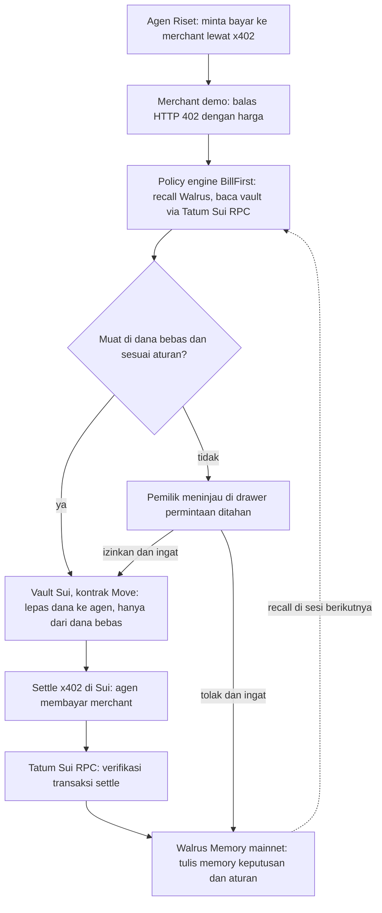

# BillFirst: Spec Final & Isi Dashboard Demo

> Note for Claude Code: this spec is written in Indonesian. Amounts use comma decimals (0,50 = 0.50 USDC). All UI copy must be English (see CLAUDE.md). Phase 2 policy engine tests must reproduce the 6 sample agent requests in "Data contoh, permintaan agen" exactly.

Nov 5, 2026 · @zora

## Ringkasan final

BillFirst: agen AI lo cuma bisa belanja dari uang yang belum lo janjikan.

| Item | Keputusan |
| --- | --- |
| Nama | BillFirst |
| Kalimat jual | Sui menjaga yang sudah dijanjikan. Walrus mengingat yang disukai. |
| Track | Consumer Finance Apps, hadiah $1.000 per track (500 / 300 / 200) |
| Bonus yang dikejar | Best Use of Agent Payments ($500, x402 settle di Sui) dan Best Walrus Memory ($500) |
| Deadline | Nov 10, 2026 17:00 UTC (Rabu 11 Nov 00:00 WIB): repo, demo, blog post |
| Syarat wajib | Walrus Memory menulis di mainnet (minimal 10 memory), Tatum RPC dipakai, blog post, demo, repo publik |
| Bobot nilai | Integrasi Walrus + Tatum 30%, kualitas teknis + Tatum Sui RPC 30%, kreativitas 20%, presentasi 20% |

Detail lomba: [Total Recall hackathon](https://recall-tatum-walrus.vercel.app/).

## Masalah dan persona

Persona: orang yang ngasih AI agent akses ke wallet. Builder dan power user yang agennya bayar per call lewat x402 untuk data, search, atau inference.

Masalah: agen belanja dari saldo yang sama dengan uang yang sudah dijanjikan untuk langganan, tagihan berbasis pemakaian, atau tabungan. Limit statis seperti "maks $5/hari" nggak tahu soal komitmen itu. Akibatnya satu kewajiban kurang dana, dan pemiliknya yang menanggung.

Contoh: saldo 20,00 USDC, sudah dijanjikan 16,50, jadi bebas 3,50. Agen sudah belanja 1,70, lalu minta 3,00 untuk laporan riset. Kalau diizinkan, cadangan kepotong 1,20. BillFirst menahannya.

| Pembanding | Kenapa belum cukup | Pembeda BillFirst |
| --- | --- | --- |
| Limit harian statis | Angkanya tetap, nggak tahu ada tagihan yang harus dibayar | Batas belanja dihitung dari komitmen yang masih jalan |
| Allowance Sui (batas + revokasi) | Membatasi agen, tapi nggak memisahkan dana kewajiban | Dana kewajiban dipisah di vault, agen nggak bisa menyentuhnya |
| Approve manual tiap transaksi | Aman tapi melelahkan, agen jadi nggak berguna | Aturan lunak belajar dari keputusan pemilik, makin jarang minta approve |

Di luar scope: tagihan rupiah offchain seperti sewa dan listrik. BillFirst hanya menjaga kewajiban yang dibayar onchain.

## Cara kerja dan pembagian peran

Kontrak Sui memegang aturan keras, Walrus Memory memegang aturan lunak, dan Tatum membuktikan setiap transaksi benar terjadi.

Alur permintaan bayar agen:

Permintaan yang muat di dana bebas dan cocok dengan aturan lolos tanpa pemilik. Sisanya ditahan, dan keputusan pemilik jadi memory yang dipakai di sesi berikutnya.

| Komponen | Tugas | Teknologi |
| --- | --- | --- |
| Kontrak vault | Simpan USDC, kunci cadangan per kewajiban, lepas dana ke agen hanya dari dana bebas, batas per permintaan dan per hari, masa berlaku izin, tarik dana oleh pemilik | Move di Sui, pola vault dari Moby |
| Policy engine | Recall memory, cek dana bebas, putuskan izinkan, tahan, atau tolak | Backend TypeScript |
| Agen demo | Membuat permintaan bayar ke merchant | Script agen plus klien x402 |
| Merchant demo | DataMart, SearchBox, ReportLab, berlabel demo | Server x402 |
| Pembayaran | Settle x402 di Sui | Library x402 Sui, contoh [@tentaclepay/sui-x402](https://www.pkgstats.com/pkg:@tentaclepay/sui-x402), divalidasi di spike hari pertama |
| Bacaan onchain | Saldo, objek vault, event, verifikasi transaksi | Tatum Sui RPC |
| Memory | Keputusan, aturan, hasil kewajiban, ringkasan sesi | Walrus Memory TypeScript SDK, mainnet |
| Dashboard | 7 layar di bawah | Next.js |

Aturan keras (kontrak, nggak bisa ditembus memory): cadangan kewajiban, batas per permintaan, batas harian, masa berlaku izin. Aturan lunak (memory): merchant mana dipercaya, kategori mana otomatis, ambang per merchant.

Jaringan: bangun di Sui testnet, rekam demo final di Sui mainnet dengan total dana di bawah 25 USDC. Dengan begitu settle x402, verifikasi Tatum, dan kepemilikan Walrus Memory ada di jaringan yang sama.

## Loop memory

Setiap keputusan pemilik jadi memory di Walrus mainnet, dan sesi berikutnya memakai memory itu untuk memutuskan sendiri. Memory cuma mengatur aturan lunak. Cadangan kewajiban dijaga kontrak Sui, jadi memory nggak bisa membuka dana yang sudah dijanjikan.

Operasi Walrus Memory yang dipakai: Remember untuk menyimpan, Recall untuk mencari memory yang mirip lewat bahasa natural. Semua memory satu pengguna disimpan di satu namespace. Memory di Walrus nggak dihapus, jadi "melupakan aturan" dicatat sebagai memory baru yang menonaktifkan aturan lama. [Walrus Memory docs](https://docs.wal.app/walrus-memory)

| Jenis memory | Ditulis saat | Contoh isi | Efek di produk |
| --- | --- | --- | --- |
| Keputusan permintaan | Setiap permintaan diizinkan, ditahan, atau ditolak | SearchBox, search premium, 1,20 USDC, diizinkan manual | Bahan recall untuk permintaan serupa |
| Aturan dari koreksi | Pemilik pilih "Izinkan & ingat" atau "Tolak & ingat" | Search dari SearchBox sampai 1,50 USDC selalu boleh | Permintaan serupa lolos atau ditolak otomatis |
| Hasil kewajiban | Setiap kewajiban jatuh tempo | Inference API: tagihan 6,80, cadangan 6,00, kurang 0,80 | Memicu usulan cadangan |
| Perubahan cadangan | Usulan cadangan diterima atau ditolak | Cadangan Inference API 6,00 jadi 7,00, disetujui | Cadangan siklus berikutnya |
| Catatan merchant | Pemilik menandai merchant | ReportLab: laporan di atas 2,00 USDC selalu tanya dulu | Merchant itu ditahan lebih ketat |
| Aturan dinonaktifkan | Pemilik menonaktifkan aturan | Aturan SearchBox dinonaktifkan | Aturan lama nggak dipakai lagi |
| Ringkasan sesi | Sesi ditutup | Sesi 1: 3 permintaan, 2 ditahan, 2 aturan baru | Kartu "Apa yang berubah" |

Bukti produk berubah, yang harus kelihatan di demo:

| Situasi | Sesi 1 (belum ada memory) | Sesi 2 (setelah belajar) |
| --- | --- | --- |
| SearchBox minta 1,20 USDC | Ditahan, merchant baru | Lolos otomatis, chip memory aturan SearchBox |
| ReportLab minta 3,00 USDC | Ditahan, memotong cadangan 1,20 | Ditahan, alasan ditambah memory penolakan sebelumnya |
| Cadangan Inference API | 6,00, ternyata kurang 0,80 | Diusulkan 7,00, pemilik setuju |
| Permintaan yang perlu ditinjau | 2 dari 3 | 1 dari 3 |

Satu putaran demo menghasilkan sekitar 15 memory, jadi syarat minimal 10 memory di mainnet terpenuhi.

## Struktur dashboard

Satu web app desktop (1440 x 900, ukuran rekaman demo) dengan sidebar kiri berisi 7 layar. Mobile nggak perlu didesain.

Urutan sidebar:

1. Ringkasan
2. Kewajiban
3. Agen (badge jumlah permintaan ditahan)
4. Memory
5. Dampak Belajar
6. Aktivitas Onchain
7. Pengaturan

Elemen yang selalu tampil di top bar:

- Logo BillFirst
- Meter "Bebas dipakai agen" dalam USDC, berubah warna kalau di bawah 1,00
- Badge jaringan Sui (Testnet atau Mainnet)
- Badge Walrus Memory: "Mainnet · 15 memory"
- Status Tatum RPC: titik hijau, kuning, atau merah plus waktu cek terakhir
- Indikator sesi: "Sesi 2"
- Alamat wallet dipendekkan plus tombol Connect atau Disconnect

Elemen global lain:

- Banner tipis mode demo: "Merchant DataMart, SearchBox, ReportLab dijalankan tim BillFirst untuk demo"
- Drawer kanan untuk detail (permintaan, kewajiban, memory, transaksi)
- Toast di kanan bawah: transaksi terkirim, transaksi terkonfirmasi, memory tersimpan, error
- Demo dock: panel kecil melayang di kanan bawah, bisa diciutkan (isi di bagian Demo dock)

## Layar 1: Ringkasan

Layar pembuka demo: dalam 5 detik juri harus paham berapa uang yang dijanjikan dan berapa yang boleh dipakai agen.

| Komponen | Isi | Aksi |
| --- | --- | --- |
| Kartu saldo utama | Total di vault, Dijanjikan, Bebas dipakai agen (angka paling besar) | Deposit |
| Bar komposisi | Bar horizontal: satu segmen per kewajiban plus segmen bebas, label nama dan jumlah | Klik segmen buka drawer kewajiban |
| Badge verifikasi | "Terverifikasi via Tatum Sui RPC · 12 detik lalu" plus ID objek vault | Buka di explorer, Muat ulang |
| Kewajiban terdekat | 3 teratas: nama, jumlah, hitung mundur jatuh tempo, status dana | Lihat semua |
| Permintaan ditahan | Jumlah plus 2 terbaru: merchant, jumlah, alasan singkat | Tinjau (buka drawer) |
| Apa yang berubah sejak sesi lalu | Dari memory ringkasan sesi: aturan baru, cadangan yang berubah, permintaan yang sekarang otomatis | Lihat di Memory |
| Statistik kecil | Uang dilindungi (USDC yang ditolak karena memotong cadangan), permintaan otomatis vs manual sesi ini | Buka Dampak Belajar |
| Aktivitas terbaru | 5 baris: jenis, jumlah, waktu, status verifikasi | Lihat semua |
| Aksi cepat | Deposit, Tambah kewajiban, Jeda agen | |

## Layar 2: Kewajiban

Tempat pemilik menentukan uang apa saja yang dijanjikan. Setiap kewajiban mengunci cadangan di vault Sui.

Tabel kewajiban, satu baris per kewajiban:

| Kolom | Isi |
| --- | --- |
| Nama | Contoh: Inference API |
| Penerima | Alamat Sui dipendekkan, bisa disalin |
| Jumlah per siklus | USDC |
| Tipe | Tetap atau Berbasis pemakaian |
| Siklus | Mingguan, Bulanan, atau Sekali |
| Jatuh tempo | Tanggal plus hitung mundur |
| Prioritas | Wajib atau Penting. Kalau dana kurang, Wajib dicadangkan duluan |
| Cadangan | Progress bar cadangan terkunci vs kebutuhan |
| Status | Terdanai penuh, Kurang dana, Dibayar, Telat |
| Aksi | Bayar sekarang, Edit, Hapus |

Komponen lain:

- Form tambah atau edit kewajiban: nama, alamat penerima, jumlah, tipe, siklus, tanggal jatuh tempo, prioritas. Simpan memicu transaksi Sui yang mengunci cadangan.
- Drawer detail kewajiban: riwayat pembayaran (dengan link transaksi), riwayat kekurangan, memory terkait, usulan cadangan aktif.
- Kartu usulan cadangan dari memory. Contoh: "Inference API: naikkan 6,00 jadi 7,00 USDC. Siklus lalu kurang 0,80." Chip memory sumbernya. Tombol Terima, Ubah angka, Tolak. Terima memicu transaksi dan menulis memory.
- Banner peringatan kalau total dijanjikan melebihi saldo: "Kurang 1,20 USDC untuk mendanai semua kewajiban." Tombol Deposit.
- Konfirmasi hapus: menghapus kewajiban melepas cadangannya ke dana bebas.

## Layar 3: Agen dan Permintaan Bayar

Layar inti demo: setiap permintaan bayar agen muncul di sini dengan keputusan dan alasannya.

Kartu agen (atas):

- Nama agen ("Agen Riset") dan alamat Sui-nya
- Status: Aktif, Dijeda, atau Dicabut
- Batas keras onchain: maksimal per permintaan dan per hari, masa berlaku izin
- Total belanja siklus ini
- Tombol Jeda dan Cabut izin (dengan konfirmasi)

Feed permintaan (real time), satu baris per permintaan:

| Kolom | Isi |
| --- | --- |
| Waktu | Jam dan detik |
| Merchant | Nama plus label "demo" |
| Item | Endpoint atau barang yang dibeli |
| Kategori | Data, Search, Inference, Riset |
| Jumlah | USDC |
| Konteks tugas | Kalimat pendek dari agen, contoh "riset harga token SUI" |
| Keputusan | Otomatis diizinkan, Ditahan, Diizinkan manual, Ditolak, Otomatis ditolak |
| Alasan | Satu baris |
| Dasar keputusan | Chip memory atau chip aturan yang dipakai |
| Transaksi | Link settle x402 kalau sudah dibayar |

Filter feed: Semua, Ditahan, Otomatis, Ditolak, plus filter kategori.

Drawer detail permintaan ditahan:

- Header: merchant, item, jumlah
- Kenapa ditahan, salah satu dari: memotong cadangan sebesar X, merchant baru, di atas aturan yang dipelajari, kategori belum dikenal
- Simulasi saldo: dana bebas sebelum dan sesudah bayar, plus kewajiban mana yang kena kalau memotong cadangan
- Hasil recall: daftar memory yang ditemukan, urut dari yang paling relevan
- Aksi: Izinkan sekali, Izinkan & ingat, Tolak, Tolak & ingat
- Kalau permintaan memotong cadangan, tombol Izinkan nonaktif dengan keterangan "Cadangan dikunci kontrak". Pilihan yang tersisa: Tolak, atau Deposit lalu izinkan.

Komposer aturan (muncul saat pilih "Izinkan & ingat" atau "Tolak & ingat"):

- Kolom teks bahasa natural, contoh "search dari SearchBox di bawah 1,50 selalu boleh"
- Preview aturan terstruktur yang bisa diedit: merchant, kategori, batas jumlah, aksi (izinkan atau tolak), berlaku sampai
- Tombol Simpan ke memory

Status pembayaran x402 per permintaan, 4 langkah kecil: tagihan 402 diterima, dana dilepas dari vault, pembayaran dikirim, settle terverifikasi via Tatum.

## Layar 4: Memory

Layar untuk juri bonus Best Walrus Memory: setiap memory kelihatan, bisa dilacak ke Walrus, dan kelihatan dipakai di keputusan mana.

Header statistik: total memory di mainnet, memory ditulis sesi ini, agent ID (MEMWAL_AGENT_ID dipendekkan), namespace, status relayer.

Tiga tab:

1. Timeline. Kartu per memory: chip jenis (warna per jenis), isi ringkas, sesi, waktu, blob ID Walrus dipendekkan plus link, status tulis (Menulis, Tersimpan di mainnet, Gagal), "dipakai di 3 keputusan". Filter per jenis dan per sesi.
2. Aturan aktif. Tabel: aturan, aksi (izinkan atau tolak), memory sumber, berapa kali dipakai, terakhir dipakai, toggle aktif. Mematikan toggle menulis memory "aturan dinonaktifkan".
3. Recall terakhir. Untuk keputusan terbaru: kalimat query yang dikirim ke Recall, daftar memory yang kembali urut relevansi, dan keputusan akhir yang diambil.

Kartu "Apa yang berubah sejak sesi lalu": dua kolom Sebelum dan Sesudah. Contoh: SearchBox 1,20 USDC (Ditahan jadi Otomatis), cadangan Inference API (6,00 jadi 7,00).

Drawer detail memory: isi lengkap, metadata (jenis, sesi, waktu, blob ID, namespace), keputusan yang memakai memory ini, tombol Buka di Walrus.

## Layar 5: Dampak Belajar

Bukti angka bahwa produk makin pintar tiap sesi. Jalankan 5 sesi sebelum rekaman final supaya setiap grafik punya 5 titik, dan beri label "Data dari 5 sesi demo".

| Grafik | Tipe | Sumbu | Pesan yang harus terbaca |
| --- | --- | --- | --- |
| Permintaan yang perlu ditinjau manual | Garis | Sesi 1 sampai 5, jumlah | Makin jarang minta approve |
| Penahanan keliru (ditahan lalu diizinkan) | Bar | Sesi, jumlah | Permintaan sah makin jarang tertahan |
| Uang dilindungi | Garis kumulatif | Sesi, USDC | Total USDC yang ditolak karena memotong cadangan |
| Kewajiban tepat waktu | Bar bertumpuk | Siklus, jumlah tepat waktu vs kurang dana | Kekurangan cadangan hilang setelah usulan diterima |
| Belanja agen per kategori | Bar horizontal | Kategori, USDC | Ke mana uang bebas dipakai |

Kartu angka di atas grafik: memory tersimpan, aturan aktif, persen keputusan otomatis sesi terakhir, total uang dilindungi.

Setiap grafik punya keterangan sumber kecil: "Dari memory Walrus + event Sui via Tatum".

## Layar 6: Aktivitas Onchain

Semua transaksi vault dan agen, masing-masing diverifikasi lewat Tatum Sui RPC. Layar ini bukti integrasi Tatum untuk 30% nilai teknis.

| Kolom | Isi |
| --- | --- |
| Waktu | Tanggal dan jam |
| Jenis | Deposit, Cadangkan, Bayar kewajiban, Lepas ke agen, Settle x402, Ubah cadangan, Tarik dana |
| Jumlah | USDC |
| Dari dan ke | Vault, nama kewajiban, agen, atau merchant |
| Digest transaksi | Dipendekkan, bisa disalin, link explorer |
| Verifikasi Tatum | Terverifikasi, Menunggu, Gagal |
| Memory terkait | Chip memory kalau ada |

Filter: jenis dan rentang tanggal.

Drawer detail transaksi: checkpoint, waktu konfirmasi, gas, event yang dipancarkan kontrak, respons mentah dari Tatum yang bisa dilipat, link explorer.

## Layar 7: Pengaturan

Kontrol pemilik dan status integrasi.

- Wallet: alamat, Deposit, Tarik dana bebas (maksimal sebesar dana bebas), Tarik semua darurat (konfirmasi dua langkah, melepas semua cadangan)
- Kebijakan default: aksi untuk merchant baru (tahan, atau izinkan sampai X USDC), aksi untuk kategori baru, ambang izin otomatis default (0,50 USDC)
- Batas keras onchain: maksimal per permintaan, maksimal per hari, masa berlaku izin agen. Simpan memicu transaksi Sui
- Agen: daftar agen (satu untuk demo), Jeda, Cabut izin
- Integrasi: Tatum (jaringan, status, API key tersamarkan), Walrus Memory (agent ID, namespace, status), facilitator x402 (URL, status)
- Mode demo: toggle banner "merchant demo"

## Demo dock dan alur demo 3 menit

Demo dock: panel kecil melayang di kanan bawah, label "Kontrol demo", bisa diciutkan. Isinya:

- Jam simulasi: "Siklus 1 · Sesi 1"
- Jalankan tugas agen, pilih skenario: Data murah (DataMart 0,50), Search merchant baru (SearchBox 1,20), Laporan mahal (ReportLab 3,00)
- Majukan siklus: pemasukan simulasi masuk, kewajiban jatuh tempo dibayar, tagihan berbasis pemakaian dihitung
- Mulai sesi baru: menulis memory ringkasan sesi, menaikkan nomor sesi
- Reset demo

Alur rekaman:

1. 0:00 Ringkasan. Saldo 20,00, dijanjikan 16,50, bebas 3,50, badge terverifikasi via Tatum.
2. 0:20 Agen beli data DataMart 0,50. Lolos otomatis (di bawah ambang default).
3. 0:35 Agen minta search SearchBox 1,20. Ditahan, merchant baru. Pilih "Izinkan & ingat", simpan aturan, lihat 4 langkah x402 sampai settle terverifikasi.
4. 1:05 Agen minta laporan ReportLab 3,00. Ditahan, memotong cadangan 1,20. Tombol Izinkan nonaktif. Pilih "Tolak & ingat".
5. 1:25 Majukan siklus. Tagihan Inference API 6,80, cadangan cuma 6,00. Muncul usulan cadangan 7,00, pemilik terima.
6. 1:50 Mulai sesi baru. Kartu "Apa yang berubah" muncul. SearchBox 1,20 lolos otomatis dengan chip memory aturan.
7. 2:15 Layar Memory: timeline, aturan aktif, recall terakhir, blob ID di Walrus mainnet.
8. 2:35 Dampak Belajar: tinjauan manual turun, uang dilindungi naik.
9. 2:50 Aktivitas Onchain: semua transaksi terverifikasi via Tatum. Tutup.

## State UI dan data contoh

Semua state di bawah perlu ada di desain, bukan cuma tampilan normal.

| State | Di mana | Tampilan |
| --- | --- | --- |
| Kosong, sesi pertama | Memory, kartu "Apa yang berubah" | "BillFirst belum kenal kebiasaan agen lo. Keputusan pertama lo jadi memory pertama." |
| Memuat | Semua kartu dan tabel | Skeleton |
| Permintaan baru masuk | Feed agen, badge sidebar | Baris baru dengan highlight singkat |
| Transaksi menunggu | Toast, baris aktivitas | Spinner "Menunggu konfirmasi Sui" |
| Transaksi sukses | Toast | Centang plus link digest |
| Transaksi gagal | Toast, drawer | Pesan error plus Coba lagi |
| Tatum RPC error | Top bar, badge verifikasi | Titik merah, "Data terakhir 2 menit lalu", Coba lagi |
| Memory menulis atau gagal | Kartu memory, toast | Chip kuning "Menulis", chip merah "Gagal" plus Coba lagi |
| Dana bebas rendah | Meter top bar | Kuning di bawah 1,00, merah di 0 |
| Kurang dana untuk kewajiban | Ringkasan, Kewajiban | Banner merah plus Deposit |
| Agen dijeda | Banner global, kartu agen | Banner kuning "Agen dijeda, semua permintaan ditolak" |
| Izin agen dicabut | Kartu agen | Kartu abu-abu, tombol Beri izin lagi |

Data contoh, kewajiban (awal Sesi 1):

| Nama | Tipe | Siklus | Prioritas | Cadangan (USDC) | Status |
| --- | --- | --- | --- | --- | --- |
| Inference API | Berbasis pemakaian | Bulanan | Wajib | 6,00 | Terdanai penuh |
| Hosting VPS | Tetap | Bulanan | Wajib | 5,00 | Terdanai penuh |
| Tabungan mingguan | Tetap | Mingguan | Penting | 4,00 | Terdanai penuh |
| Domain renewal | Tetap | Sekali | Penting | 1,50 | Terdanai penuh |

Data contoh, saldo vault (USDC):

| Titik | Total | Dijanjikan | Bebas |
| --- | --- | --- | --- |
| Awal Sesi 1 | 20,00 | 16,50 | 3,50 |
| Akhir Sesi 1 | 18,30 | 16,50 | 1,80 |
| Awal Sesi 2 (setelah siklus, pemasukan simulasi 17,00) | 18,00 | 16,00 | 2,00 |

Data contoh, permintaan agen:

| Sesi | Merchant | Item | Kategori | USDC | Keputusan | Alasan |
| --- | --- | --- | --- | --- | --- | --- |
| 1 | DataMart | Harga historis token | Data | 0,50 | Otomatis diizinkan | Sesuai ambang default 0,50 |
| 1 | SearchBox | Search premium | Search | 1,20 | Diizinkan manual | Merchant baru |
| 1 | ReportLab | Laporan riset onchain | Riset | 3,00 | Ditolak | Memotong cadangan 1,20 |
| 2 | SearchBox | Search premium | Search | 1,20 | Otomatis diizinkan | Aturan SearchBox sampai 1,50 |
| 2 | DataMart | Harga historis token | Data | 0,50 | Otomatis diizinkan | Sesuai ambang default 0,50 |
| 2 | ReportLab | Laporan riset onchain | Riset | 3,00 | Ditahan | Memotong cadangan 2,70, pernah ditolak |

Nama lain untuk mockup: agen "Agen Riset", alamat contoh 0x7a3f...c91e, namespace "billfirst-demo".

## Checklist fitur

Centang satu per satu saat desain dari Claude Design masuk. Semua harus ada sebelum mulai coding UI.

Global:

- [ ] Sidebar 7 layar dengan badge permintaan ditahan
- [ ] Top bar: meter dana bebas, badge jaringan Sui, badge Walrus Memory, status Tatum, indikator sesi, wallet
- [ ] Banner mode demo
- [ ] Drawer kanan (permintaan, kewajiban, memory, transaksi)
- [ ] Toast (menunggu, sukses, gagal, memory tersimpan)
- [ ] Demo dock yang bisa diciutkan

Ringkasan:

- [ ] Kartu saldo: total, dijanjikan, bebas
- [ ] Bar komposisi per kewajiban
- [ ] Badge terverifikasi via Tatum
- [ ] Kewajiban terdekat, permintaan ditahan, apa yang berubah, statistik kecil, aktivitas terbaru
- [ ] Aksi cepat: Deposit, Tambah kewajiban, Jeda agen

Kewajiban:

- [ ] Tabel 10 kolom dengan progress bar cadangan
- [ ] Form tambah dan edit
- [ ] Drawer detail kewajiban
- [ ] Kartu usulan cadangan (Terima, Ubah angka, Tolak)
- [ ] Banner kurang dana dan konfirmasi hapus

Agen:

- [ ] Kartu agen dengan batas keras, Jeda, Cabut izin
- [ ] Feed permintaan dengan filter
- [ ] Drawer permintaan ditahan: alasan, simulasi saldo, hasil recall, 4 aksi
- [ ] Tombol Izinkan nonaktif saat memotong cadangan
- [ ] Komposer aturan dengan preview terstruktur
- [ ] Status x402 empat langkah

Memory:

- [ ] Header statistik
- [ ] Tab Timeline, Aturan aktif, Recall terakhir
- [ ] Kartu sebelum dan sesudah
- [ ] Drawer detail memory dengan link Walrus

Dampak Belajar:

- [ ] Kartu angka dan 5 grafik dengan label sumber

Aktivitas Onchain:

- [ ] Tabel transaksi dengan status verifikasi Tatum, filter, drawer detail

Pengaturan:

- [ ] Wallet, kebijakan default, batas keras, agen, integrasi, toggle mode demo

State:

- [ ] Semua 12 state di tabel State UI
