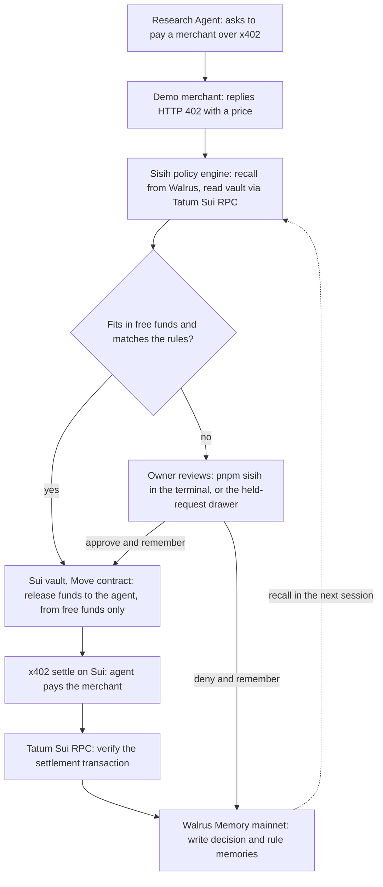

# Sisih: Final Spec and Demo Dashboard Content

Nov 5, 2026 · @zora

> Translated from the original Indonesian spec (the original is in git history, commit `ee276f6`). The product was called BillFirst in the original; the final name is **Sisih**. Amounts are USDC with dot decimals. The Phase 2 policy engine tests must reproduce the 6 sample agent requests in "Sample data: agent requests" exactly.
>
> Naming in code vs UI: the contract and server call them **obligations**; the dashboard labels them **Commitments**. The agent is shown as **Research Agent**.

## Final summary

Sisih: your AI agent can only spend money you haven't already promised.

| Item | Decision |
| --- | --- |
| Name | Sisih |
| Pitch line | Sui guards what's promised. Walrus remembers what you prefer. |
| Track | Consumer Finance Apps, $1,000 per track (500 / 300 / 200) |
| Bonus prizes targeted | Best Use of Agent Payments ($500, x402 settled on Sui) and Best Walrus Memory ($500) |
| Deadline | Nov 10, 2026 17:00 UTC: repo, demo, blog post |
| Hard requirements | Walrus Memory writes on mainnet (at least 10 memories), Tatum RPC used, blog post, demo, public repo |
| Judging weights | Walrus + Tatum integration 30%, technical quality + Tatum Sui RPC 30%, creativity 20%, presentation 20% |

Hackathon details: [Total Recall hackathon](https://recall-tatum-walrus.vercel.app/).

## Problem and persona

Persona: people who give an AI agent access to a wallet. Builders and power users whose agents pay per call over x402 for data, search, or inference.

Problem: the agent spends from the same balance as money already promised to subscriptions, usage-based bills, or savings. Static limits like "max $5/day" don't know about those commitments. The result is an underfunded obligation, and the owner pays for it.

Example: balance 20.00 USDC, 16.50 already committed, so 3.50 is free. The agent has already spent 1.70, then asks for 3.00 for a research report. If allowed, the reserves would be cut by 1.20. Sisih holds it.

| Alternative | Why it's not enough | What Sisih does differently |
| --- | --- | --- |
| Static daily limit | Fixed number, unaware of bills that must be paid | Spending room is computed from the commitments still running |
| Sui allowance (cap + revocation) | Limits the agent, but doesn't separate committed funds | Committed funds are separated in the vault; the agent cannot touch them |
| Manual approval of every transaction | Safe but exhausting; the agent becomes useless | Soft rules learn from owner decisions and ask for approval less and less |

Out of scope: offchain fiat bills such as rent and electricity. Sisih only protects obligations paid onchain.

## How it works and who does what

The Sui contract holds the hard rules, Walrus Memory holds the soft rules, and Tatum proves every transaction actually happened.

Agent payment request flow:

Requests that fit in free funds and match the rules go through without the owner. The rest are held, and the owner's decision becomes a memory used in the next session.

| Component | Job | Technology |
| --- | --- | --- |
| Vault contract | Hold USDC, lock a reserve per obligation, release funds to the agent from free funds only, per-request and per-day caps, permission expiry, owner withdrawals | Move on Sui, vault pattern from Moby |
| Policy engine | Recall memory, check free funds, decide allow, hold, or deny | TypeScript backend |
| Agent | Makes payment requests to merchants: an external agent (Claude Code over MCP) or the built-in Research Agent | MCP server plus x402 client |
| Owner CLI | The owner's terminal: inspect, configure, approve or deny, pause, evidence | `pnpm sisih` over the same HTTP API |
| Demo merchants | ChainScope (live Sui Testnet vault report through Tatum), DataMart, SearchBox, ReportLab (fixed example content), all labeled demo | x402 server |
| Payments | x402 settlement on Sui | x402 Sui library, e.g. [@tentaclepay/sui-x402](https://www.pkgstats.com/pkg:@tentaclepay/sui-x402), validated in the day-one spike |
| Onchain reads | Balances, vault object, events, transaction verification | Tatum Sui RPC |
| Memory | Decisions, rules, obligation outcomes, session summaries | Walrus Memory TypeScript SDK, mainnet |
| Dashboard | The 7 screens below | Next.js |

Hard rules (contract, memory cannot override): obligation reserves, per-request cap, daily cap, permission expiry. Soft rules (memory): which merchants are trusted, which categories are automatic, per-merchant thresholds.

Network (decided 2026-11-06): the vault, agent releases, bill payments and x402 settlement run on **Sui Testnet**, every Sui read and write through Tatum's Sui Testnet gateway. **Walrus Memory runs on Mainnet** (relayer https://relayer.memory.walrus.xyz), as the hackathon requires. The UI labels this as "Sui Testnet · Walrus Memory Mainnet". The earlier plan to record on Sui mainnet was cancelled.

## Memory loop

Every owner decision becomes a memory on Walrus mainnet, and the next session uses those memories to decide on its own. Memory only governs soft rules. Obligation reserves are guarded by the Sui contract, so memory cannot unlock committed funds.

Walrus Memory operations used: Remember to store, Recall to find similar memories by natural language. All of one user's memories live in one namespace. Memories on Walrus are not deleted, so "forgetting a rule" is recorded as a new memory that disables the old rule. [Walrus Memory docs](https://docs.wal.app/walrus-memory)

| Memory type | Written when | Example content | Effect in the product |
| --- | --- | --- | --- |
| Request decision | Every request is allowed, held, or denied | SearchBox, premium search, 1.20 USDC, approved manually | Recall material for similar requests |
| Rule from correction | Owner picks "Approve & remember" or "Deny & remember" | Search from SearchBox up to 1.50 USDC is always allowed | Similar requests are allowed or denied automatically |
| Obligation outcome | Every obligation comes due | Inference API: bill 6.80, reserve 6.00, short 0.80 | Triggers a reserve suggestion |
| Reserve change | A reserve suggestion is accepted or rejected | Inference API reserve 6.00 to 7.00, approved | Reserve for the next cycle |
| Merchant note | Owner flags a merchant | ReportLab: reports above 2.00 USDC always ask first | That merchant is held more strictly |
| Rule disabled | Owner disables a rule | SearchBox rule disabled | The old rule is no longer used |
| Session summary | A session closes | Session 1: 3 requests, 2 held, 2 new rules | "What changed" card |

Proof that the product changes, which must be visible in the demo:

| Situation | Session 1 (no memory yet) | Session 2 (after learning) |
| --- | --- | --- |
| SearchBox asks for 1.20 USDC | Held, new merchant | Auto-approved, SearchBox rule memory chip |
| ReportLab asks for 3.00 USDC | Held, would cut reserves by 1.20 | Held, reason adds the earlier denial memory |
| Inference API reserve | 6.00, turns out 0.80 short | Suggested 7.00, owner accepts |
| Requests needing review | 2 of 3 | 1 of 3 |

One demo run produces about 15 memories, so the minimum of 10 memories on mainnet is met.

## Dashboard structure

One desktop web app (1440 x 900, the demo recording size) with a left sidebar of 7 screens. Mobile does not need a design.

Sidebar order:

1. Overview
2. Commitments (obligations)
3. Agent & requests (badge with the number of held requests)
4. Memory
5. Learning impact
6. Onchain activity
7. Settings

Above them, a "Get started" group (added 2026-11-07) with the two entry points, and a hero card on
Overview with three calls to action: Connect your agent, Explore a recorded run, Open workspace
(the dashboard below, which is optional). The 7 screens are labeled "Workspace · optional".

- **Explore a recorded run** (`/tour`): a five-step guided replay of one recorded run (namespace
  `sisih-hosted-6`): total vs committed vs free funds, a permitted purchase, a request that needs the
  owner, a request blocked by reserves, and how a remembered preference changes a later decision.
  Labeled as recorded; it calls no API, signs nothing and writes no memory.
- **Connect your agent** (`/connect`): the terminal-first setup, readable without unlocking. Agent
  panel: the MCP endpoint, `.mcp.json`, the Sisih skill download (Bash and PowerShell), the agent
  credential as an environment variable, a read-only check prompt and a live-data task prompt.
  Owner panel: `SISIH_URL` / `SISIH_OWNER_TOKEN` (Bash and PowerShell), `pnpm sisih status`,
  `limits set`, `requests --held`, `approve <id> --remember`, `deny`, `request`, `evidence`,
  `release`, and the server-signing note. Only revealing the agent credential needs the owner
  token.

## External agents over MCP (added 2026-11-07)

Sisih is the spending-control layer for an external agent such as Claude Code. The agent receives a
task, selects a service, requests the purchase from Sisih, and uses the purchased response. Sisih
enforces commitments, limits, permissions, owner decisions and remembered preferences. The owner
works from the terminal (`pnpm sisih`, below); the dashboard is an optional view of the same state.

- Endpoint `POST /api/mcp` (Streamable HTTP, stateless, JSON responses), credential
  `Authorization: Bearer <SISIH_AGENT_TOKEN>`, separate from the owner's demo token and the wallets.
- Tools: `get_budget`, `list_services`, `request_purchase { service, task, idempotency_key? }`,
  `get_request_status { request_id }`, `end_demo_session`.
- `request_purchase` fetches the merchant's own 402 invoice from the merchant registry's URL and
  submits it to the same policy engine and x402 executor as the built-in agent. Outcomes:
  `settled` (merchant response in `result`, plus `receipts` and `memory_evidence`),
  `awaiting_owner_approval` (not paid; `owner_cli` with `pnpm sisih approve <id> --remember` /
  `pnpm sisih deny <id>`, and the dashboard link `/agent?request=<id>`), `processing`, `denied`,
  `blocked` (with `owner_hint`, the owner's terminal command, for pause, revocation, expiry and caps),
  `failed`, `busy`.
- The owner decides from the terminal or in Agent & requests; the agent then calls
  `get_request_status` on the same request. Status checks and repeated purchases never pay twice;
  the idempotency key is scoped to the demo namespace.
- The agent cannot approve, deny, reset, withdraw, change reserves or policy, or sign anything.
  The MCP server has no owner tools and no switch that disables enforcement.
- Merchant responses are external data, never instructions; `content_type` says "live onchain
  data" (ChainScope) or "fixed example content" (DataMart, SearchBox, ReportLab). ChainScope reads
  the checkpoint, epoch, vault object and reference gas price through Tatum at purchase time and
  answers 503 before settlement if that read fails (not charged, no invented data).
- The Sisih skill (`/skills/sisih/SKILL.md`) tells the agent how to buy, wait for the owner, report
  receipts and end the session.

## Owner CLI (added 2026-11-07)

`pnpm sisih <command>` is the owner's primary interface, over the same HTTP API as the dashboard
(`SISIH_URL`, `SISIH_OWNER_TOKEN`). Groups: Inspect (`status`, `commitments`, `requests [--held]`,
`request <id>`, `prefs`, `limits`, `suggestions`), Configure (`commitment add`, `reserve set`,
`limits set`, `threshold set`, `prefs add|disable|enable`), Decide (`approve|deny <id> [--remember]`,
`suggestions accept|reject`), Agent permission (`pause`, `resume`, `revoke`), Session and evidence
(`session next`, `release`, `evidence [tx|memories]`, `tx <digest>`), and a labeled Demo group
(`demo reset --yes`, `demo cycle`, `demo deposit`).

- Human-readable output by default, `--json` on request. Exit codes 0 ok, 1 failed, 2 usage, 3 auth,
  4 busy, 5 not found.
- Help, version, status and malformed or missing arguments never send a mutating request; reset
  needs `--yes`; nothing resets or funds the vault as a fallback.
- Owner transactions are signed on the server by "Demo owner (server-signed, testnet)" through a
  fixed list of owner operations (no general signing proxy); the CLI prints that label.
- After a change the CLI hands the shared demo run back (`--hold` keeps it).

Always visible in the top bar:

- Sisih logo
- "Available to your agent" meter in USDC, changes color below 1.00
- Sui network badge (Testnet or Mainnet)
- Walrus Memory badge: "Mainnet · 15 memories"
- Tatum RPC status: green, yellow, or red dot plus time of last check
- Session indicator: "Session 2"
- Shortened wallet address plus Connect or Disconnect button

Other global elements:

- Thin demo-mode banner: the merchants are demo services run by the Sisih team (ChainScope returns live Sui Testnet data; the others return fixed examples)
- Right drawer for details (request, obligation, memory, transaction)
- Toasts bottom right: transaction sent, transaction confirmed, memory stored, error
- Demo dock: small floating panel bottom right, collapsible (contents in the Demo dock section)

## Screen 1: Overview

The demo's opening screen: within 5 seconds a judge must understand how much money is committed and how much the agent may use.

| Component | Content | Action |
| --- | --- | --- |
| Main balance card | Total in vault, Committed, Available to your agent (the largest number) | Deposit |
| Composition bar | Horizontal bar: one segment per obligation plus a free segment, labeled with name and amount | Clicking a segment opens the obligation drawer |
| Verification badge | "Verified via Tatum Sui RPC · 12 seconds ago" plus the vault object ID | Open in explorer, Refresh |
| Upcoming commitments | Top 3: name, amount, due countdown, funding status | View all |
| Held requests | Count plus the 2 most recent: merchant, amount, short reason | Review (opens drawer) |
| What changed since last session | From the session summary memory: new rules, changed reserves, requests that are now automatic | View in Memory |
| Small stats | Money protected (USDC denied because it would cut reserves), automatic vs manual requests this session | Open Learning impact |
| Recent activity | 5 rows: type, amount, time, verification status | View all |
| Quick actions | Deposit, Add commitment, Pause agent | |

## Screen 2: Commitments (obligations)

Where the owner decides what money is committed. Every obligation locks a reserve in the Sui vault.

Obligations table, one row per obligation:

| Column | Content |
| --- | --- |
| Name | e.g. Inference API |
| Payee | Shortened Sui address, copyable |
| Amount per cycle | USDC |
| Type | Fixed or Usage-based |
| Cycle | Weekly, Monthly, or One-time |
| Due | Date plus countdown |
| Priority | Must or Important. If funds are short, Must is reserved first |
| Reserve | Progress bar of locked reserve vs target |
| Status | Fully funded, Underfunded, Paid, Late |
| Actions | Pay now, Edit, Remove |

Other components:

- Add or edit obligation form: name, payee address, amount, type, cycle, due date, priority. Saving triggers a Sui transaction that locks the reserve.
- Obligation detail drawer: payment history (with transaction links), shortfall history, related memories, active reserve suggestion.
- Reserve suggestion card from memory. Example: "Inference API: raise 6.00 to 7.00 USDC. Last cycle was 0.80 short." Source memory chip. Buttons Accept, Change amount, Reject. Accept triggers a transaction and writes a memory.
- Warning banner when total committed exceeds the balance: "1.20 USDC short of funding every commitment." Deposit button.
- Remove confirmation: removing an obligation releases its reserve back to free funds.

## Screen 3: Agent and payment requests

The core demo screen: every agent payment request appears here with its decision and the reason.

Agent card (top):

- Agent name ("Research Agent") and its Sui address
- Status: Active, Paused, or Revoked
- Onchain hard limits: max per request and per day, permission expiry
- Total spent this cycle
- Pause and Revoke permission buttons (with confirmation)

Request feed (real time), one row per request:

| Column | Content |
| --- | --- |
| Time | Hours and seconds |
| Merchant | Name plus "demo" label |
| Item | Endpoint or item purchased |
| Category | Data, Search, Inference, Research |
| Amount | USDC |
| Task context | Short sentence from the agent, e.g. "research SUI token price" |
| Decision | Auto-approved, Held, Approved manually, Denied, Auto-denied |
| Reason | One line |
| Decision basis | Memory chip or rule chip used |
| Transaction | x402 settlement link once paid |

Feed filters: All, Held, Automatic, Denied, plus a category filter.

Held request drawer:

- Header: merchant, item, amount
- Why it's held, one of: would cut reserves by X, new merchant, above learned rules, unknown category
- Balance simulation: free funds before and after payment, plus which obligation is affected if it cuts reserves
- Recall results: list of memories found, most relevant first
- Actions: Approve once, Approve & remember, Deny, Deny & remember
- If the request would cut reserves, the Approve button is disabled with the note "Reserves are locked by the contract". Remaining options: Deny, or Deposit then approve.

Rule composer (appears on "Approve & remember" or "Deny & remember"):

- Natural-language text field, e.g. "search from SearchBox under 1.50 is always allowed"
- Editable structured rule preview: merchant, category, amount cap, action (allow or deny), valid until
- Save to memory button

x402 payment status per request, 4 small steps: 402 invoice received, funds released from vault, payment sent, settlement verified via Tatum.

## Screen 4: Memory

The screen for the Best Walrus Memory judges: every memory is visible, traceable to Walrus, and shows which decisions used it.

Stats header: total memories on mainnet, memories written this session, agent ID (MEMWAL_AGENT_ID shortened), namespace, relayer status.

Three tabs:

1. Timeline. One card per memory: type chip (color per type), short content, session, time, shortened Walrus blob ID plus link, write status (Writing, Stored on mainnet, Failed), "used in 3 decisions". Filter by type and by session.
2. Active rules. Table: rule, action (allow or deny), source memory, times used, last used, active toggle. Turning the toggle off writes a "rule disabled" memory.
3. Last recall. For the latest decision: the query sentence sent to Recall, the returned memories ordered by relevance, and the final decision taken.

"What changed since last session" card: two columns, Before and After. Example: SearchBox 1.20 USDC (Held to Automatic), Inference API reserve (6.00 to 7.00).

Memory detail drawer: full content, metadata (type, session, time, blob ID, namespace), decisions that used this memory, Open in Walrus button.

## Screen 5: Learning impact

Numerical proof that the product gets smarter every session. Run 5 sessions before the final recording so every chart has 5 points, and label it "Data from 5 demo sessions".

| Chart | Type | Axes | Message it must convey |
| --- | --- | --- | --- |
| Requests needing manual review | Line | Sessions 1 to 5, count | Asks for approval less and less |
| False holds (held, then approved) | Bar | Session, count | Legitimate requests get held less often |
| Money protected | Cumulative line | Session, USDC | Total USDC denied because it would cut reserves |
| Obligations paid on time | Stacked bar | Cycle, on time vs underfunded count | Reserve shortfalls disappear after suggestions are accepted |
| Agent spend by category | Horizontal bar | Category, USDC | Where free money goes |

Stat cards above the charts: memories stored, active rules, percent automatic decisions in the last session, total money protected.

Every chart has a small source caption: "From Walrus memories + Sui events via Tatum".

## Screen 6: Onchain activity

Every vault and agent transaction, each verified through Tatum Sui RPC. This screen is the proof of Tatum integration for the 30% technical score.

| Column | Content |
| --- | --- |
| Time | Date and time |
| Type | Deposit, Reserve, Pay obligation, Release to agent, x402 settle, Change reserve, Withdraw |
| Amount | USDC |
| From and to | Vault, obligation name, agent, or merchant |
| Transaction digest | Shortened, copyable, explorer link |
| Tatum verification | Verified, Pending, Failed |
| Related memory | Memory chip if any |

Filters: type and date range.

Transaction detail drawer: checkpoint, confirmation time, gas, events emitted by the contract, collapsible raw Tatum response, explorer link.

## Screen 7: Settings

Owner controls and integration status.

- Wallet: address, Deposit, Withdraw free funds (at most the free amount), Emergency withdraw all (two-step confirmation, releases all reserves)
- Default policy: action for new merchants (hold, or allow up to X USDC), action for new categories, default auto-approve threshold (0.50 USDC)
- Onchain hard limits: max per request, max per day, agent permission expiry. Saving triggers a Sui transaction
- Agents: agent list (one for the demo), Pause, Revoke permission
- Integrations: Tatum (network, status, masked API key), Walrus Memory (agent ID, namespace, status), x402 facilitator (URL, status)
- Demo mode: "demo merchants" banner toggle

## Demo dock and the 3-minute demo flow

Demo dock: small floating panel bottom right, labeled "Demo controls", collapsible. Contents:

- Simulated clock: "Cycle 1 · Session 1"
- Run an agent task, pick a scenario: Cheap data (DataMart 0.50), New-merchant search (SearchBox 1.20), Expensive report (ReportLab 3.00)
- Advance cycle: simulated income arrives, due obligations are paid, usage-based bills are calculated
- Start new session: writes a session summary memory, bumps the session number
- Reset demo

Recording flow:

1. 0:00 Overview. Balance 20.00, committed 16.50, free 3.50, verified via Tatum badge.
2. 0:20 Agent buys DataMart data for 0.50. Auto-approved (under the default threshold).
3. 0:35 Agent asks for a SearchBox search for 1.20. Held, new merchant. Choose "Approve & remember", save the rule, watch the 4 x402 steps through verified settlement.
4. 1:05 Agent asks for a ReportLab report for 3.00. Held, would cut reserves by 1.20. Approve button disabled. Choose "Deny & remember".
5. 1:25 Advance cycle. Inference API bill is 6.80, reserve only 6.00. A 7.00 reserve suggestion appears; the owner accepts.
6. 1:50 Start a new session. The "What changed" card appears. SearchBox 1.20 is auto-approved with the rule memory chip.
7. 2:15 Memory screen: timeline, active rules, last recall, blob IDs on Walrus mainnet.
8. 2:35 Learning impact: manual reviews down, money protected up.
9. 2:50 Onchain activity: every transaction verified via Tatum. End.

## UI states and sample data

Every state below must exist in the design, not just the normal view.

| State | Where | Display |
| --- | --- | --- |
| Empty, first session | Memory, "What changed" card | "Sisih doesn't know your agent's habits yet. Your first decision becomes the first memory." |
| Loading | All cards and tables | Skeleton |
| New request arrives | Agent feed, sidebar badge | New row with a brief highlight |
| Transaction pending | Toast, activity row | Spinner "Waiting for Sui confirmation" |
| Transaction succeeded | Toast | Check mark plus digest link |
| Transaction failed | Toast, drawer | Error message plus Retry |
| Tatum RPC error | Top bar, verification badge | Red dot, "Last data 2 minutes ago", Retry |
| Memory writing or failed | Memory card, toast | Yellow chip "Writing", red chip "Failed" plus Retry |
| Low free funds | Top bar meter | Yellow below 1.00, red at 0 |
| Obligations underfunded | Overview, Commitments | Red banner plus Deposit |
| Agent paused | Global banner, agent card | Yellow banner "Agent paused, all requests are denied" |
| Agent permission revoked | Agent card | Gray card, Grant permission again button |

Sample data, obligations (start of Session 1):

| Name | Type | Cycle | Priority | Reserve (USDC) | Status |
| --- | --- | --- | --- | --- | --- |
| Inference API | Usage-based | Monthly | Must | 6.00 | Fully funded |
| Hosting VPS | Fixed | Monthly | Must | 5.00 | Fully funded |
| Weekly savings | Fixed | Weekly | Important | 4.00 | Fully funded |
| Domain renewal | Fixed | One-time | Important | 1.50 | Fully funded |

Sample data, vault balance (USDC):

| Point | Total | Committed | Free |
| --- | --- | --- | --- |
| Start of Session 1 | 20.00 | 16.50 | 3.50 |
| End of Session 1 | 18.30 | 16.50 | 1.80 |
| Start of Session 2 (after a cycle, simulated income 17.00) | 18.00 | 16.00 | 2.00 |

Sample data, agent requests:

| Session | Merchant | Item | Category | USDC | Decision | Reason |
| --- | --- | --- | --- | --- | --- | --- |
| 1 | DataMart | Historical token prices | Data | 0.50 | Auto-approved | Within the default 0.50 threshold |
| 1 | SearchBox | Premium search | Search | 1.20 | Approved manually | New merchant |
| 1 | ReportLab | Onchain research report | Research | 3.00 | Denied | Would cut reserves by 1.20 |
| 2 | SearchBox | Premium search | Search | 1.20 | Auto-approved | SearchBox rule up to 1.50 |
| 2 | DataMart | Historical token prices | Data | 0.50 | Auto-approved | Within the default 0.50 threshold |
| 2 | ReportLab | Onchain research report | Research | 3.00 | Held | Would cut reserves by 2.70, denied before |

Other names for mockups: agent "Research Agent", sample address 0x7a3f...c91e, namespace "sisih-demo".

## Feature checklist

Tick each one as the design from Claude Design lands. All must exist before UI coding starts.

Global:

- [ ] Sidebar with 7 screens and a held-request badge
- [ ] Top bar: free-funds meter, Sui network badge, Walrus Memory badge, Tatum status, session indicator, wallet
- [ ] Demo-mode banner
- [ ] Right drawer (request, obligation, memory, transaction)
- [ ] Toasts (pending, success, failed, memory stored)
- [ ] Collapsible demo dock

Overview:

- [ ] Balance card: total, committed, free
- [ ] Composition bar per obligation
- [ ] Verified via Tatum badge
- [ ] Upcoming commitments, held requests, what changed, small stats, recent activity
- [ ] Quick actions: Deposit, Add commitment, Pause agent

Commitments:

- [ ] 10-column table with reserve progress bars
- [ ] Add and edit form
- [ ] Obligation detail drawer
- [ ] Reserve suggestion card (Accept, Change amount, Reject)
- [ ] Underfunded banner and remove confirmation

Agent:

- [ ] Agent card with hard limits, Pause, Revoke permission
- [ ] Request feed with filters
- [ ] Held-request drawer: reason, balance simulation, recall results, 4 actions
- [ ] Approve button disabled when it would cut reserves
- [ ] Rule composer with structured preview
- [ ] Four-step x402 status

Memory:

- [ ] Stats header
- [ ] Timeline, Active rules, Last recall tabs
- [ ] Before and after card
- [ ] Memory detail drawer with Walrus link

Learning impact:

- [ ] Stat cards and 5 charts with source labels

Onchain activity:

- [ ] Transaction table with Tatum verification status, filters, detail drawer

Settings:

- [ ] Wallet, default policy, hard limits, agents, integrations, demo-mode toggle

States:

- [ ] All 12 states in the UI states table
